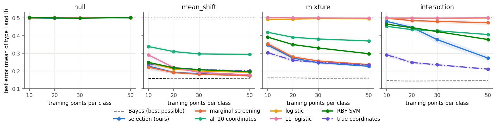
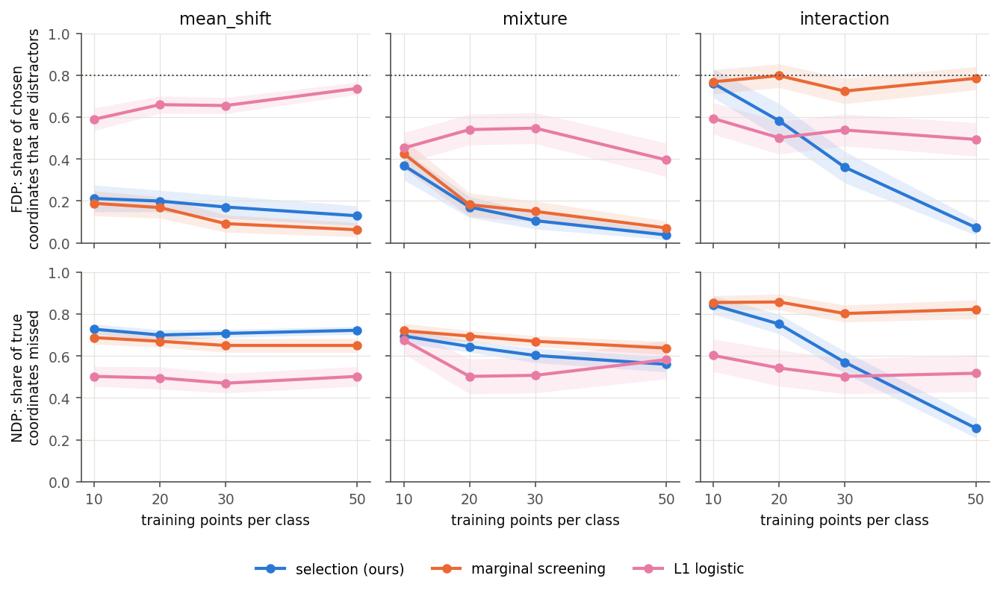
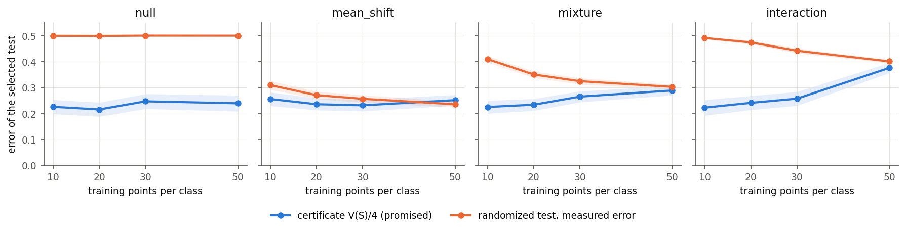
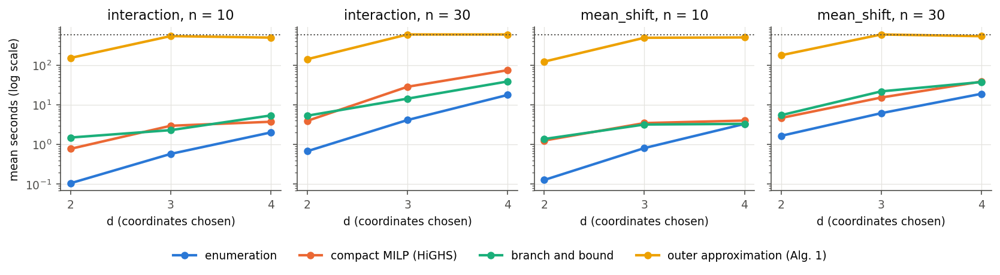

# 阅读指南：从零读懂这篇笔记、代码和实验

这份指南面向第一次接触这个项目的读者：讲清问题是什么，每个公式在说什么，代数推导用了哪些操作，
算法和代码里数据怎么流动，实验为什么这样设计，以及怎么读结果。每个术语第一次出现时都有解释。

公式编号对应英文正式笔记 [note/robust_coordinate_selection.pdf](../note/robust_coordinate_selection.pdf)：
式 (1)–(9)，引理 2.1，命题 2.2–2.4，附录 A–C。实验数字和图来自 [results/study20-v3/summary.md](../results/study20-v3/summary.md)。

**维护约定**：正式笔记、核心代码或实验改动后，同步更新这份指南（公式编号、代码行号、数字）。

## 目录

0. [一句话说清这篇在做什么](#0-一句话说清这篇在做什么)
1. [基本概念](#1-基本概念)
2. [公式逐个拆解：式 (1)–(5)](#2-公式逐个拆解式-15)
3. [式 (6)–(9) 的代数推导怎么理解](#3-式-69-的代数推导怎么理解)
4. [计算流：数据怎么经过各个函数](#4-计算流数据怎么经过各个函数)
5. ["证书"、"检验"、"测试"分别是什么](#5-证书检验测试分别是什么)
6. [实验设计：4 个真坐标藏在 16 个干扰坐标里](#6-实验设计4-个真坐标藏在-16-个干扰坐标里)
7. [怎么看结果](#7-怎么看结果)
8. [计算实验和 MILP 基线](#8-计算实验和-milp-基线)
9. [现在的问题](#9-现在的问题)
10. [复现和修改](#10-复现和修改)

---

## 0. 一句话说清这篇在做什么

有两类数据，比如"健康"和"患病"，每个样本有 $D=20$ 个测量值（坐标）。我们想**只用其中 $d$ 个坐标**（比如 2 个）造一个判别规则，判断新样本属于哪一类。

难点在于训练样本很少（每类 10 或 30 个），真实分布不知道。所以我们不只看这几个样本，还要求：**就算真实分布和样本有一定偏差，判别规则也不会差太多**。论文要回答两件事：

- 选哪 $d$ 个坐标，最坏情况下的错误最小？
- 这个"选坐标"的组合问题怎么算？

---

## 1. 基本概念

| 词 | 白话意思 |
|---|---|
| 类 0、类 1 | 两组数据。$x^{(0)}_i$ 是类 0 的第 $i$ 个样本，是 20 维向量 |
| 坐标 | 向量的一个分量。$x[m]$ 是第 $m$ 个坐标；$x[S]$ 只保留集合 $S$ 里的坐标 |
| 检测器 $f$（也叫"检验"、"判别规则"） | 给每个点打一个分数 $f(x)$。分数 $\ge0$ 判为类 0，$<0$ 判为类 1 |
| 损失 $\ell$ | 分数打错时罚多少。代码里用 hinge：$\ell(t)=\max(0,1+t)$ |
| 经验分布 $\widehat{\mathbb P}_k$ | 把类 $k$ 的 $n$ 个样本各看成质量 $1/n$ 的一小堆沙 |
| Wasserstein 距离 $\mathcal W_1$ | 把一堆沙搬成另一堆沙时，"质量 × 搬运距离"之和的最小值。距离用 $\ell_1$：各坐标差的绝对值之和 |
| 半径 $\rho_k$ | 允许的总搬运量。真实分布被假定落在"离样本搬运量不超过 $\rho_k$"的范围里，这个范围叫 Wasserstein 球 |
| 对手 | 一个想象中的坏人：在球里挑出让检测器表现最差的分布。"最坏情况"就是对手挑出来的情况 |

**损失怎么读。** 类 0 的样本希望分数为正，罚的是 $\ell(-f)=\max(0,1-f)$：
- $f\ge1$ 时不罚；
- $f=0$（犹豫）罚 1；
- $f=-1$（判反）罚 2。

类 1 反过来，罚 $\ell(f)=\max(0,1+f)$。代码把分数限制在 $[-1,1]$ 里。理论部分对一般的 $\ell$ 都成立（非负、不减、凸、$\ell(0)=1$），hinge 只是代码里的具体选择。

---

## 2. 公式逐个拆解：式 (1)–(5)

### 式 (1)：最坏风险 $R(f)$

$$R(f)=\sup_{\mathbb P_0\in\mathcal P_0,\ \mathbb P_1\in\mathcal P_1}\Big\{\mathbb E_{\mathbb P_0}\ell(-f(X))+\mathbb E_{\mathbb P_1}\ell(f(X))\Big\}$$

- $\mathbb E_{\mathbb P_0}\ell(-f(X))$：类 0 的平均罚分。
- 加号后面：类 1 的平均罚分。
- $\sup$：对手在两个球里各挑一个分布，让总罚分最大。

所以 **$R(f)$ 是"给定一个检测器 $f$，它在最坏情况下的总罚分"**。
- 它是检测器的函数，换一个 $f$ 就换一个值。
- 取值范围是 0 到 2：常数检测器 $f\equiv0$ 两类各罚 1，所以 $R=2$；任何检测器的最坏值都不会更差。

### 式 (2)：选择问题

$$\min_{|S|\le d}\ \min_{f\in\mathcal F_S} R(f)$$

$\mathcal F_S$ 是"只看 $S$ 里的坐标"的所有检测器。整个式子是：先选坐标集合 $S$，再在只用这些坐标的检测器里挑最好的，让最坏风险最小。

### $V(S)$ 和 $R(f)$ 的区别

$$V(S)=\min_{f\in\mathcal F_S}R(f)$$

- $R(f)$ 给**一个检测器**打分。
- $V(S)$ 给**一组坐标**打分：在只用 $S$ 的检测器里挑最好的那个，它的最坏风险就是 $V(S)$。

$V(S)$ 只由训练样本、$S$ 和半径决定，能算出来。选择问题就是 $\min_{|S|\le d}V(S)$。

### 式 (3)：对手怎么做（引理 2.1）

Gao 等 (2018) 证明了一件事：对手不需要把沙子搬到任意位置，**只需要搬到已有的样本点上**（记这些目标点的集合为 $\mathcal X$）。于是：

$$V(S)=\max_{\gamma}\ \sum_{y\in\mathcal X}\psi\big(p_0(y),p_1(y)\big)$$

逐项看：
- $\gamma^{(k)}_{i,y}$：类 $k$ 的第 $i$ 个样本搬到目标点 $y$ 的质量。每个样本的质量 $1/n_k$ 必须全部分出去。
- $p_0(y)$、$p_1(y)$：搬完之后，点 $y$ 上类 0 和类 1 各有多少质量。
- 预算约束：类 $k$ 的总搬运量（只按 $S$ 上的坐标算距离）不超过 $\rho_k$。距离只算 $S$ 上的坐标，是因为检测器只看得见 $S$；在其他坐标上怎么动，检测器察觉不到，所以不花预算。
- $\psi(a,b)=\inf_t\{a\,\ell(-t)+b\,\ell(t)\}$：一个点上有类 0 质量 $a$、类 1 质量 $b$。检测器在这个点只能打一个分数 $t$，打得最好时这个点的罚分是多少。

**hinge 下的具体值。** 对 $t\in[-1,1]$，罚分 $a(1-t)+b(1+t)$ 是 $t$ 的一次函数，最小值在端点：
- $t=1$ 时是 $2b$；
- $t=-1$ 时是 $2a$。

所以 $\psi(a,b)=2\min(a,b)$。意思是：**两类在同一个点上"叠在一起"的质量，检测器无论怎么打分都要吃亏**。

**一句话：对手的策略是在预算内，让两类在检测器看得见的坐标上尽量重合。** 好的 $S$ 能让两类离得很远，对手搬不到一起。

**小例子。** 只有一个坐标。类 0 两个点 $\{0,1\}$，类 1 两个点 $\{3,4\}$，每个点质量 $1/2$，总预算 $\rho_0+\rho_1=1$。
- 最近的跨类点对是 1 和 3，距离 2。
- 把这一对的质量 $1/2$ 搬到一起（比如都搬到 2），花费 $\frac12\times2=1$，正好用完预算。
- 重合质量是 $\frac12$，所以 $V=2\times\frac12=1$。

hinge 下这条规律对任何数据都成立：$V(S)=2\,m_S$，$m_S$ 是"预算内最多能让多少质量跨类配对"。实验代码就用这个形式算 $V(S)$（见第 4 节）。

### 式 (4)：防守方怎么做——检测器线性规划（命题 2.2）

式 (3) 是对手的最大化问题；把它"翻过来"（数学上叫取对偶，证明在附录 A），得到防守方要解的最小化问题：

$$V(S)=\min_{g,a,\lambda}\ \frac1{n_0}\sum_i a^{(0)}_i+\frac1{n_1}\sum_j a^{(1)}_j+\rho_0\lambda_0+\rho_1\lambda_1$$

约束对每个样本 $i$ 和每个目标点 $y$ 各有一条：

$$\ell(-g_y)\le a^{(0)}_i+\lambda_0\,\|x^{(0)}_i[S]-y[S]\|_1$$

（类 1 的约束同理）。变量是：
- $g_y$：检测器在样本点 $y$ 上的分数。这就是我们要学的东西。
- $\lambda_k$：搬运的"单价"。对手每搬一单位距离，要付 $\lambda_k$。
- $a^{(k)}_i$：样本 $i$ 的"最坏净罚分"。

**约束怎么读。** 想象对手把类 0 的样本 $x_i$ 搬到 $y$：
- 收益是那里的罚分 $\ell(-g_y)$；
- 成本是"距离 × 单价"。

约束说的是：无论搬到哪里，"收益 − 成本"都不超过 $a_i$。

**目标怎么读。** 平均每个样本的最坏净罚分，加上"预算 × 单价"。
- 单价高，对手不愿意搬远，$a$ 可以小，但要多付 $\rho\lambda$；
- 单价低则反过来。

线性规划求解器会自动找到平衡点。

**这些量怎么求出来的。** $g$、$a$、$\lambda$ 是求解器（HiGHS，一个线性规划求解器）一起算出来的，没有手写公式。但有两个关系可以帮你理解：
- 给定 $g$ 和 $\lambda$，$a_i$ 就确定了：$a_i=\max_y\{\ell(\pm g_y)-\lambda\cdot\text{距离}\}$。代码在求解后正是这样重算 $a$ 的。
- 求解器同时给出每条约束的"影子价格"（数学上叫对偶乘子）。这些数恰好就是式 (3) 里对手的搬运方案 $\gamma$。所以**解一次 (4) 就同时拿到防守方的检测器和对手的最坏搬运**。

**(3)→(4) 用了什么操作（附录 A）。** 两步：
1. **交换"对手先"和"防守先"的顺序**（Sion 极小极大定理）：对手的最大化和检测器的最小化可以交换次序，值不变。条件是一边是凸的、另一边是线性的，而且搬运方案的范围是有界闭集。
2. **线性规划对偶**：分数 $g$ 固定后，对手的问题是一个线性规划。每条约束配一个"价格"，就得到对偶问题：质量守恒约束的价格是 $a_i$，预算约束的价格是 $\lambda_k$。

### 式 (5)：新点怎么打分（命题 2.3）

(4) 只给出样本点上的分数，新点 $\xi$ 要另外定规则。

先定义"包络"：

$$E_k(\xi)=\min_i\{a^{(k)}_i+\lambda_k\|x^{(k)}_i[S]-\xi\|_1\}$$

它是从样本出发、按单价 $\lambda_k$ 爬坡得到的上限。新点的分数只要满足 $\ell(-g(\xi))\le E_0(\xi)$ 和 $\ell(g(\xi))\le E_1(\xi)$，就能保证整个检测器的最坏风险仍然等于 $V(S)$。

论文选的具体规则是：
1. 每类找一个"锚点"：类 0 取使 $E_0(\xi)$ 最小的样本 $i$，类 1 取使 $E_1(\xi)$ 最小的样本 $j$。
2. 记 $r_0$、$r_1$ 是新点到两个锚点的距离。
3. 令 $\tau=r_0/(r_0+r_1)$，新分数是 $g(\xi)=(1-\tau)g_i+\tau g_j$。

也就是离哪个锚点近，分数就更像哪个锚点。

**为什么满足 (5)（附录 B）。** 两步不等式：
- $\ell$ 是凸的，所以混合后的罚分不超过两端罚分的混合；
- 三角不等式 $b\le r_0+r_1$（$b$ 是两锚点间的距离）给出 $\tau b\le r_0$，于是罚分被 $E_0(\xi)$ 控制住。

---

## 3. 式 (6)–(9) 的代数推导怎么理解

### 3.1 要解决的问题

$V(S)$ 只对"整个子集"有定义，$S$ 是离散的。我们想要一个**关于 0/1 向量 $z$ 的函数**：它在 $z=\mathbf 1_S$ 时等于 $V(S)$（$\mathbf 1_S$ 是 $S$ 里的位置为 1、其余为 0 的向量），并且结构足够简单，能用"一条条直线"去逼近。有了直线，就能用整数规划在所有子集上同时找下界，不用一个个去试。

整个推导用了三个代数操作：

| 操作 | 在哪里 | 作用 |
|---|---|---|
| 把"只算 $S$ 上的花费"写成"每个坐标可以花钱买豁免" | $\mathcal D$ 里的 $\mu$ | 让 $S$ 从约束里移到目标函数里，变成 $\mu^\top z$ |
| 允许总质量变化，用比值、再取倒数 | 式 (6) | 目标变成 $z$ 的一次函数，于是能画直线 |
| "一族直线的最低点是凹的" | 式 (7)、(8) | 每算一个子集就得到一条对所有子集都有效的直线 |

### 3.2 第一步：把"只在 $S$ 上算花费"变成"买豁免"

式 (3) 的预算约束是

$$\sum_{m\in S}c_k(\gamma)[m]\le\rho_k,$$

其中 $c_k(\gamma)[m]$ 是类 $k$ 在坐标 $m$ 上的总搬运量。这个约束里，$S$ 决定"哪些坐标的花费要算进预算"，它藏在求和下标里，没法当成变量来优化。

改写：给每个坐标 $m$ 一个"豁免额度" $\rho_k\mu_m$。坐标 $m$ 上的花费，前 $\rho_k\mu_m$ 单位不算进预算，只有超出的部分算：

$$\sum_{m=1}^D\big(c_k(\gamma)[m]-\rho_k\mu_m\big)_+\le\rho_k M(\gamma),\qquad t_+=\max\{t,0\}.$$

豁免不是免费的：选中的坐标（$z_m=1$）要付 $\mu_m$，没选的坐标（$z_m=0$）不用付。总费用是 $\mu^\top z$。

在 $z=\mathbf 1_S$ 时，最聪明的做法是：
- 没选的坐标给足够大的豁免（反正不花钱），它们的花费就都不算了；
- 选中的坐标不买豁免（$\mu_m=0$），花费全算。

这正好还原了"只在 $S$ 上算花费"。于是 $S$ 从约束里挪到了目标函数里的 $\mu^\top z$，这就是我们要的。

### 3.3 第二步：为什么是比值、为什么取倒数

买豁免的钱 $\mu^\top z$ 和对手的收益 $H(\gamma)$（重合质量的罚分，就是式 (3) 的目标）不在一个单位上，不能直接相减。办法是**缩小搬运方案**：

> 给一对 $(\gamma,\mu)$，令 $s=M(\gamma)+\mu^\top z$。把方案 $\gamma$ 整体缩小 $s$ 倍，剩下的质量留在原地不动，
> 得到的新方案在 $S$ 上不超预算（附录 C.1 的构造）。缩小后的收益至少是 $H(\gamma)/s$。

所以

$$F(z)=\max_{(\gamma,\mu)\in\mathcal D}\ \frac{H(\gamma)}{M(\gamma)+\mu^\top z}$$

读作：**任选一个搬运方案和一组豁免，缩到合规之后，对手最多能拿到多少**。分母里有两部分：
- $M(\gamma)$：方案的质量。允许它不等于 1，但缩完总质量不能超过 1，所以要除以它。
- $\mu^\top z$：在选中坐标上"不能豁免"的花费，需要额外缩小才能付得起。

$\mathcal D$ 里另一条约束（每个样本搬出的质量都是 $M(\gamma)/n_k$）保证两类的质量一起缩放。

**取倒数。** 把 $(\gamma,\mu)$ 同时乘一个正数，比值不变（$H$、$M$ 和约束都随之按比例变化）。所以可以规定 $H(\gamma)=1$，这时比值的最大值的倒数就是分母的最小值：

$$\frac1{F(z)}=\min\big\{M(\gamma)+\mu^\top z:\ (\gamma,\mu)\in\mathcal D,\ H(\gamma)\ge1\big\}.\tag{6}$$

**关键在这里**：可行集 $\{(\gamma,\mu)\in\mathcal D,\ H\ge1\}$ 和 $z$ 无关，而目标 $M(\gamma)+\mu^\top z$ 对 $z$ 是一次函数（直线、平面）。所以 **$1/F(z)$ 是一族直线的最低点**。

### 3.4 第三步：式 (7)——为什么 $F$ 是凸的、在 0/1 点上等于 $V(S)$

- **一族直线的最低点是凹函数**（想象几条直线，取每个位置最低的那条，画出来是向下弯的折线）。所以 $1/F$ 凹，而且因为 $\mu\ge0$，它随 $z$ 增大而不减。
- $t\mapsto1/t$ 在正数上是凸的、递减的，"凸递减函数套一个凹函数"是凸函数。所以 $F$ 凸，并且随 $z$ 增大而不增：多选坐标不会更差。
- 在 0/1 点上：附录 C.1 从两个方向证明 $F(\mathbf 1_S)=V(S)$。
  - $F\le V$：任何 $(\gamma,\mu)$ 缩小后都是式 (3) 的合规方案，所以拿不到比 $V(S)$ 更多。
  - $F\ge V$：取式 (3) 的最优方案，配上 3.2 节的豁免（选中坐标 $\mu=0$，没选的坐标 $\mu_m=\max_kc_k[m]/\rho_k$），正好拿到 $V(S)$。

这就是式 (7)：

$$F(\mathbf 1_S)=V(S),\qquad\min_{|S|\le d}V(S)=\min_{z\in\mathcal Z_d}F(z).$$

### 3.5 式 (8)：一次计算得到一条对所有子集都有效的直线

在子集 $S^t$ 上解一次，得到一对最优的 $(\gamma^t,\mu^t)$。把它代入 (6) 的目标，就是一条直线：

$$c_t(z)=M(\gamma^t)+(\mu^t)^\top z.\tag{8}$$

因为 (6) 是对所有可行点取最小，而 $(\gamma^t,\mu^t)$ 只是其中一个，所以对**任何** $z$ 都有 $1/F(z)\le c_t(z)$，也就是 $F(z)\ge1/c_t(z)$。在 $z^t$ 处取等号。这条直线叫"割"。

**代入具体数**（附录 C.1 给出了这对最优点，不用另外求解）：$\gamma^t=\gamma^\star/V(S^t)$，没选的坐标上 $\mu_m=\max_kc_k(\gamma^\star)[m]/(\rho_kV(S^t))$。对另一个子集 $T$，割化简成

$$V(T)\ \ge\ \frac{V(S^t)}{1+\sum_{m\in T\setminus S^t}\pi_m},\qquad\pi_m=\max_k\frac{c_k(\gamma^\star)[m]}{\rho_k}.$$

$\pi_m$ 读作"旧方案在坐标 $m$ 上的搬运量是预算的多少倍"。$T$ 比 $S^t$ 多出的坐标，旧方案要为它们付钱，付得越多，下界就越低。这就是代码里的"比值割"（`ratio_cut`）。

### 3.6 式 (9)：主问题——在所有直线下找最乐观的子集

手上有 $t$ 条直线，每条都满足 $F(z)\ge1/c_s(z)$，所以

$$F(z)\ \ge\ \frac1{\min_sc_s(z)}.$$

对所有子集取最小：$\min_zF(z)\ge1/\max_z\min_sc_s(z)$。于是解

$$\max_{z\in\mathcal Z_d,\,\theta}\ \theta\quad\text{s.t.}\quad\theta\le c_s(z),\ s=1,\dots,t,\tag{9}$$

得到 $\theta_t$，下界 $L_t=1/\theta_t$。取到最大值的 $z^{t+1}$ 是"根据已有直线看起来最有希望的子集"，下一轮就算它。这是一个小的整数规划：$z$ 是 0/1 变量，约束是 $t$ 条直线。

### 3.7 一个算到底的小例子：为什么割很弱

$D=2$，$d=1$。类 0 两个点 $(0,9)$、$(9,0)$，类 1 一个点 $(0,0)$，$\rho_0=\rho_1=0.15$。

1. 先算 $S=\{1\}$（只看坐标 1）：$(0,0)$ 和 $(0,9)$ 已经重合，对手不花钱就能把它们配在一起，$V(\{1\})=1.07$。
2. 这个方案在坐标 2 上要把 $(0,0)$ 和 $(0,9)$ 配在一起，相距 9，花费是预算的很多倍：$\pi_2\ge15$，求解器给出 31。
3. 割说：$V(\{2\})\ge1.07/(1+31)\approx0.03$。主问题只好去试 $\{2\}$，下界只有 $L=0.03$。
4. 算 $\{2\}$：这次重合的是 $(0,0)$ 和 $(9,0)$，$V(\{2\})=1.07$，又得到一条对称的割。
5. 两条割合在一起，下界升到 1.07，等于目前最好的值，停止。

**两个子集都要算一遍，割一个都没排除掉。** 原因是：真正的对手看到新子集后会换一种配对（第 1 步配的是 $(0,9)$，第 4 步配的是 $(9,0)$），而割只会把旧配对缩小后照搬。搬运方案本身（谁配谁）和坐标无关，和坐标有关的是它的花费。在原空间里两个对手几乎都没移动点，变的是"在检测器眼里哪两个点重合"。20 维实验里外逼近慢，原因也是这个（第 8 节）。

### 3.8 推导里用到的数学操作，一张表

| 操作 | 白话 | 在哪里 |
|---|---|---|
| 交换 max 和 min（Sion 定理） | "对手先出手"和"防守方先出手"结果一样 | (3)→(4)，附录 A |
| 线性规划对偶 | 给每条约束标一个价格，得到一个值相同的最小化问题 | (3)→(4)；MILP 基线 |
| 一次齐次（同乘一个正数，比例关系不变） | 允许缩放，于是可以规定 $H=1$ | (6)，附录 C |
| "缩小再补足"的构造 | 不合规的方案缩小到合规，剩下的质量留在原地 | 附录 C.1；代码 `feasible_plan` |
| 一族直线的最低点是凹的 | 折线向下弯 | (6)→(7)，割 (8) |
| 用新变量替换乘积 | $\lambda z_m$ 换成 $w_m$，再用线性约束把它管住 | MILP 基线（第 8 节） |
| 把 0/1 变量放宽成 0 到 1 的数 | 得到一个能算的下界 | 承诺界（第 8 节） |

---

## 4. 计算流：数据怎么经过各个函数

### 4a. 核心算法包（正式笔记里的算法 1）

核心代码在 `src/robusthw/algorithm/` 目录下，只有三个文件。

```
Problem(x0, x1, [ρ0, ρ1])                 model.py:25   存数据和半径
   │  .distance(S) = Σ_{m∈S}|x_i[m]-x_r[m]|                 所有点对在 S 上的距离
   ▼
select(problem, d, "oa")                  selection.py:205
   └─ _outer_approximation                selection.py:119  （算法 1）
        ├─ evaluate(S) → fit_fixed(problem, S)   oracle.py:93
        │      1. 用 HiGHS 解式 (4) → g（分数）, λ（单价）
        │      2. 重算 a = max(0, max_r(1+σ g_r − λ d_ir))
        │         upper = Σ q_i a_i + ρ·λ                   这就是 V(S)
        │      3. 约束的影子价格 = 对手方案 γ（式 (3)）
        │         feasible_plan 修成严格可行（oracle.py:57，第 3.8 节的"缩小再补足"）
        │         lower = hinge_value(γ) = 2Σ_y min(p0, p1)  （V(S) 的下界，用来核对）
        │      4. ratio_cut(γ, S) → 一条割（式 (8)）        oracle.py:77
        ├─ master(所有割) → 下一个 z 和下界 L（式 (9)）     selection.py:38
        └─ 当 U − L ≤ 容差时停止
   ▼
FitResult.predict_score(新点)             model.py:148   用式 (5) 给新点打分
```

`fit_fixed` 里式 (4) 的写法：

```python
# 变量顺序 [a (n), lambda (2), g (n)]；
# 第 (i, r) 行：-a_i - lambda_k d_ir + sigma_k g_r <= -1
```

这一行就是约束 $\ell(\sigma_k g_r)\le a_i+\lambda_k d_{ir}$ 在 hinge 下的样子：$\ell(\sigma g)=1+\sigma g$，类 0 取 $\sigma=-1$，类 1 取 $\sigma=+1$，移项后得到上面的形式。

`ratio_cut` 存的割是 `Cut(1/H, mu/H)`，即 $1/F(z)\le(1+\mu^\top z)/H$，正是式 (8) 在 $M=1$ 时的形式。

### 4b. 实验代码（`src/robusthw/experiments/study20.py`）

一次重复（`accuracy_task`，第 264 行）的流程：

```
draw(case, n, trial)                       第 106 行
   sample（第 63 行）生成训练集（每类 n 个）、测试集（每类 1000 个）；
   log_ratio（第 90 行）用已知的真实密度算 Bayes 检验在测试集上的两类错误；
   随机打乱 20 个坐标的顺序，记下真坐标被打乱到了哪些位置。
   ▼
cross_validate                             第 195 行
   5 折交叉验证：每次用 4/5 训练，1/5 验证。
   对 d=1..4 和 17 个半径：
     robust_values → 每个子集的 V(S)        第 141 行
     joint：选 V 最小的子集；marginal：选单坐标 V 最小的 d 个
     robust_fit（= fit_fixed）训练检测器 → 在验证部分算错误率
   选出验证错误率最低的 (d, 半径)。
   ▼
用全部训练数据和选出的 (d, 半径) 重新训练
   ▼
predict_score(测试点) → test_errors（第 166 行）：
   type1            = 类 0 测试点被判成类 1 的比例
   type2            = 类 1 测试点被判成类 0 的比例
   error            = (type1 + type2) / 2
   randomized_error = 随机化检验在测试集上的错误率
   certificate      = fit.upper / 4 = V(S)/4
   ▼
baselines（第 237 行，三个对比方法）、recovery（第 230 行，FDP/NDP）
```

汇总和画图在 `study20_summary.py`、`study20_figures.py`：读 `accuracy.json` 和 `computation.json`，写出 `summary.md` 和 `figures/*.png`。

**实验里 $V(S)$ 是怎么算的。** `robust_values` 用 hinge 下的配对形式 $V(S)=2m_S$，不需要解线性规划：
1. `matching_curve`（第 124 行）用匈牙利算法（一种经典的最优配对算法）算出：恰好配 $k$ 对跨类点时，最少的总距离是多少（除以 $n$）。$k$ 从 0 取到 $n$。
2. 得到一条"配对数 ↔ 花费"的曲线，反过来查"给定预算最多配多少"，就是 $m_S$。
3. 一次查表就得到所有 17 个半径上的值。

测试里专门核对过：这样算出的值和 `fit_fixed` 解线性规划得到的值一致（`tests/test_study20.py`）。

### 4c. 建议的读代码顺序

1. `model.py:25` 的 `Problem`：数据怎么存，`distance` 怎么算。
2. `oracle.py:93` 的 `fit_fixed`：对应式 (4)，最核心。
3. `model.py:148` 的 `predict_score`：对应式 (5)。
4. `oracle.py:51,57,77`：对手方案 → 下界 → 割（式 (8)）。
5. `selection.py:38,119`：主问题（式 (9)）和算法 1。
6. 实验部分：`study20.py:63 sample` → `106 draw` → `124/141` 配对算 V → `195 cross_validate` → `264 accuracy_task` → `300 compact_program`（MILP）→ `337 BranchAndBound` → `414 computation_task`。

---

## 5. "证书"、"检验"、"测试"分别是什么

**"检验"（test）有两个意思，一定要分开：**
- 统计学里的"假设检验"，就是判别规则，即检测器 $f$。原假设 $H_0$："这个点来自类 0"；备择假设 $H_1$："来自类 1"。
- "测试集"：额外生成的一批新数据，专门用来量真实错误率。每类 1000 个点，训练时完全没见过。

**两类错误。** 检验会犯两种错：
- **第一类错误**：点其实来自类 0，却被判成类 1（错误地拒绝了 $H_0$）。
- **第二类错误**：点其实来自类 1，却被判成类 0（漏掉了差别）。

实验报告的"测试错误率"是两者的平均。掷硬币的检验两类错误加起来是 1，平均是 0.5；永远判类 0 的检验第一类错误是 0、第二类是 1，平均也是 0.5。所以**只看平均会掩盖不对称**，结果页里把两类错误分开列了。

**确定性检验 vs 随机化检验。** 有了分数 $g\in[-1,1]$，有两种判法：
- **确定性**：$g\ge0$ 判类 0。实验表里的错误率都是它的。
- **随机化**：以概率 $(1+g)/2$ 判类 0。这样：
  - 类 0 的样本被判错的概率是 $(1-g)/2=\ell(-g)/2$；
  - 类 1 的样本被判错的概率是 $(1+g)/2=\ell(g)/2$；
  - 两类错误率的平均 $=\frac14\big(\ell(-g)+\ell(g)\big)$ 的期望。

  所以**随机化检验在最坏情况下的平均错误率是 $R(f)/4$**。最优检测器的 $R(f)=V(S)$，因此最坏错误率是 $V(S)/4$。

**证书**就是 $V(S)/4$，一个只用训练数据就能算出的承诺："只要真实分布确实在 Wasserstein 球里，随机化检验的平均错误率就不超过这个数。" 它的取值范围是 0 到 0.5（0.5 等于掷硬币）。

**"证书成立"** 的意思是：在测试集上量出的随机化错误率 ≤ 证书。如果半径太小、真实分布不在球里，承诺就可能失效。

**什么是已知的"标准答案"（GT，ground truth）：**

| 量 | 模拟数据 | 真实数据 |
|---|---|---|
| 真实分布 | 已知（是我们自己设的） | 不知道 |
| Bayes 错误率（任何检验能达到的最低错误） | 已知：用真实密度比在测试点上算 | 不知道 |
| 真坐标（哪 4 个坐标两类不同） | 已知 → 能算 FDP/NDP | 不知道 |
| 测试错误率、两类错误 | 用 1000×2 个新点量出 | 只能留一部分数据来估 |
| $V(S)$、证书 | 只用训练数据算 | 同样只用训练数据算 |

所以模拟实验的意义是：用已知的标准答案，检查方法在拿不到答案的真实数据上靠不靠得住。

---

## 6. 实验设计：4 个真坐标藏在 16 个干扰坐标里

### 6.1 要回答的问题

这篇的场景是：**两类数据只在少数几个坐标上不同，其余坐标都是干扰；每类只有几十个训练点**。实验就照这个场景造数据：

- 每个样本 20 个坐标；
- **4 个真坐标**：两类在这里的分布不同；
- **16 个干扰坐标**：和其他一切独立，两类分布完全相同，对判别毫无帮助，只会添乱；
- 每类训练点 $n=10,20,30,50$。

然后回答三个问题，外加一个计算问题：

1. **能不能分开两类？** 看测试错误率和两类错误，和 Bayes 错误率（最好能做到的）、0.5（掷硬币）比。
2. **能不能找到真坐标？** 看选出的坐标里有多少是干扰（FDP）、漏了多少真坐标（NDP）。
3. **证书靠不靠得住？** 看证书 $V(S)/4$ 是否不低于实际量出的错误率。
4. **选择问题算得动吗？** 比较几种精确算法的时间（第 8 节）。

### 6.2 数据怎么造

下面 $x[1..4]$ 指真坐标，$x[5..20]$ 指干扰坐标（每次重复会打乱顺序，这里写打乱前的位置）。

| 情形 | 真坐标上：类 0 对 类 1 | 干扰坐标（两类相同） | 来源 | 测什么 |
|---|---|---|---|---|
| `null` | 没有真坐标，两类完全一样 | 20 个独立的 $N(0,1)$ | — | 虚警：任何方法都应该是 0.5 |
| `mean_shift` | $N(0,\Sigma)$ 对 $N(\mu,\Sigma)$，$\mu=(2,1,0.67,0.5)$，$\Sigma_{ab}=0.5^{\lvert a-b\rvert}$ | 16 个独立的 $N(0,1)$ | Wang–Dey–Xie (2023) 情形 I | 最常见的稀疏信号：类 1 整体挪了位置，单个坐标就看得到 |
| `mixture` | $N(0,I)$ 对 $N(\pm\mu,I)$（每个点随机取正负号） | 16 个独立的 $N(0,1)$ | Wang–Dey–Xie (2023) 情形 IV | 两类均值相同，类 1 更分散：画直线分不开 |
| `interaction` | 类 0：$\tfrac12N(c_0,I)+\tfrac12N(-c_0,I)$，$c_0=(1,1,1,1)$；类 1 同样，$c_1=(1,1,-1,-1)$ | 16 个独立的 $\tfrac12N(1,1)+\tfrac12N(-1,1)$ | Xie–Gao–Xie (2021) §5.1 的混合，放在 4 个坐标上 | 信号只在坐标之间的关系里 |

逐个用白话说：

- **`mean_shift`**：类 1 在第 1 个真坐标上平均高 2，第 2 个高 1，第 3 个高 0.67，第 4 个高 0.5，越往后越弱。4 个真坐标之间有相关（相邻相关 0.5）。干扰坐标两类都是标准正态。只看第 1 个坐标就能分得不错，后面几个坐标帮助越来越小。
- **`mixture`**：类 0 在真坐标上是标准正态；类 1 先掷硬币，正面就整体加 $\mu$，反面就整体减 $\mu$。两类均值都是 0，但类 1 沿 $\mu$ 方向散得更开。所以"画一条直线分两边"的方法（逻辑回归）看不见差别，要看"离中心多远"。
- **`interaction`**：最难的一种。类 0 的 4 个真坐标"一起变"：要么都在 +1 附近，要么都在 −1 附近。类 1 是"前两个和后两个反着变"：要么 $(+1,+1,-1,-1)$ 附近，要么 $(-1,-1,+1,+1)$ 附近。**单看任何一个坐标，两类都是"一半在 +1、一半在 −1"，完全一样**。干扰坐标也故意造成同样的"一半 +1、一半 −1"，所以单看一个坐标，连真坐标和干扰坐标都分不出来。只有把真坐标**组合起来看**，才看得到差别。

**为什么干扰坐标要"和一切独立、两类相同"。** 这样似然比 $p_1(x)/p_0(x)$ 只依赖 4 个真坐标，"哪些坐标有用"就有了唯一的标准答案，Bayes 错误率也和只用真坐标时一样。这一点有测试检查（`tests/test_study20.py` 的 `test_distractors_are_the_same_in_both_classes_and_carry_no_information`）。

**为什么每次重复都打乱坐标。** 很多子集的 $V$ 值会并列，代码并列时取下标最小的那个。如果真坐标总在前 4 个位置，并列时就会"碰巧"选对。打乱以后，真坐标在哪里是随机的。

**三个信号情形的 Bayes 错误率**都在 0.14–0.16，难度相近，方便横向比较。

### 6.3 一次重复从头到尾（真实数据）

以 `interaction`、$n=50$、第 2 次重复为例，数字都来自 `accuracy.json`。

1. **生成数据。** 类 0、类 1 各 50 个训练点、各 1000 个测试点，每个点 20 维。打乱后真坐标落在 {7, 12, 16, 19}（从 0 编号）。用真实密度算出 Bayes 检验在这 2000 个测试点上的错误：第一类 0.154，第二类 0.140，平均 0.147。
2. **交叉验证选参数。** 把每类 50 个训练点分成 5 份，每份 10 个。轮流拿 4 份（每类 40 个）训练、剩下 1 份（每类 10 个）验证。对"选择"方法：
   - 在 17 个半径 × 4 个 $d$ 上，用 40 个点算出每个子集的 $V(S)$，取最小的子集；
   - 在这个子集上训练检测器，在验证的 10+10 个点上数错了几个；
   - 5 份轮完，把验证错误率加起来。
   
   $17\times4=68$ 组参数里，验证错误率最低的是 $d=4$、半径 3.16。
3. **重新训练。** 用全部 50+50 个点、$d=4$、半径 3.16 再选一次，选出 {7, 12, 16, 19}，正好是 4 个真坐标。在这 4 个坐标上解式 (4) 得到检测器。
4. **在测试集上评价。**
   - 第一类错误 0.204，第二类 0.208，测试错误率 0.206（Bayes 0.147）；
   - FDP = 0（选中的都是真坐标），NDP = 0（一个没漏）；
   - 证书 $V(S)/4=0.481$，随机化检验实际错误 0.410，证书成立。
5. **同一份数据上的其他方法：** 边际筛选选了 {3, 12, 15, 19}，两真两假，错误率 0.384；全部 20 个坐标 0.425（第一类 0.157、第二类 0.693，很不对称）；逻辑回归 0.499；L1 逻辑回归把所有系数都压成 0、一个坐标都没选，永远判类 0（第一类 0、第二类 1），错误率 0.5；SVM 0.366。

每个情形、每个 $n$ 重复 100 次（共 $4\times4\times100=1600$ 次），表里报平均。62 个进程并行约 1 小时。

### 6.4 方法和基线

| 方法 | 做什么 | 交叉验证调什么 | 和它比，回答什么问题 |
|---|---|---|---|
| **选择**（本文） | 在所有 $d$ 个坐标的组合里取 $V(S)$ 最小的，在上面训练稳健检验 | $d\in\{1,2,3,4\}$、半径 | — |
| 边际筛选 | 每个坐标单独算 $V(\{m\})$，取最小的 $d$ 个，再训练同样的稳健检验 | $d$、半径 | 唯一差别是"一个个看"还是"组合着看"，差距就是联合选择的价值 |
| 全部坐标 | 20 个坐标全用的稳健检验，即 Xie 等 (2021) 的方法 | 半径 | 差距就是干扰坐标的代价，也就是"选坐标"本身的价值 |
| 真坐标 | 直接在 4 个真坐标上训练稳健检验 | 半径 | 参照：如果有人告诉你真坐标，能做到多好。实际中拿不到 |
| 逻辑回归 | 用全部坐标拟合一条直线（高维里是平面）分开两类 | L2 正则强度 | Xie 等用的基线：最常用的线性方法 |
| L1 逻辑回归 | 同上，但会把没用的坐标的系数压成 0，相当于自动选坐标 | L1 正则强度 | Wang 等用的稀疏基线：另一种"选坐标"的方法 |
| RBF SVM | 用高斯核，可以画弯曲的分界线 | 惩罚参数 C | Xie 等用的灵活基线：不选坐标、但能画任意形状 |

几点细节：
- 所有方法都按**验证错误率**调参，比较才公平。
- 稳健方法的半径网格是 0.01 到 100 之间 17 个对数等距的点，两类各分一半。
- 基线的正则参数在 $10^{-4}$ 到 $10^4$ 之间 10 个点上选（sklearn 的默认范围）。
- 稳健方法都用 hinge 损失、$\ell_1$ 距离。

### 6.5 指标怎么算

设测试集里类 0 有 $N_0=1000$ 个点，类 1 有 $N_1=1000$ 个点。

- **第一类错误** $=\dfrac{\#\{\text{类 0 测试点被判成类 1}\}}{N_0}$，**第二类错误** $=\dfrac{\#\{\text{类 1 测试点被判成类 0}\}}{N_1}$。
- **测试错误率** $=\dfrac{\text{第一类}+\text{第二类}}2$。例：第一类 0.204、第二类 0.208，测试错误率 0.206。
- **Bayes 错误率**：用真实密度比 $p_1(x)/p_0(x)$ 判（大于 1 判类 1），在同一批测试点上按同样公式算。它是理论下限，任何方法平均都不会比它低。
- **FDP**（选错比例）$=\dfrac{|S\setminus\text{真坐标}|}{|S|}$；**NDP**（漏选比例）$=\dfrac{|\text{真坐标}\setminus S|}{4}$。
  - 例：真坐标 {7,12,16,19}，选了 {3,12,15,19}，FDP $=2/4=0.5$，NDP $=2/4=0.5$。
  - 随机挑 $d$ 个坐标：FDP 约 0.8（20 个里 16 个是干扰），NDP $=1-d/20$。
  - 一个都没选时记 FDP $=0$、NDP $=1$。
- **证书** $=V(S)/4$；**随机化错误** = 随机化检验在测试集上的两类错误平均；**成立比例** = 100 次里证书 ≥ 随机化错误的比例。
- **平均和标准误**：表里写"0.273 (0.007)"，前者是 100 次的平均，括号里是标准误 = 100 次的标准差 $/\sqrt{100}$，表示"平均值本身有多不准"。图里的阴影带是平均 ± 2 个标准误，两条线的带不重叠，差别就基本不是运气。

---

## 7. 怎么看结果

全部图表在 [results/study20-v3/summary.md](../results/study20-v3/summary.md)。下面挑重点。

### 7.1 能不能分开两类（图 `figures/error.png`）



**怎么读这张图**：每个小图是一个情形，横轴是每类训练点数，纵轴是测试错误率。黑色虚线是 Bayes 错误率（最好能做到的），顶上的点线是 0.5（掷硬币）。线越低越好；越往右（样本越多）应该越低。紫色点划线"真坐标"是拿不到的参照。

测试错误率（100 次平均）：

| 方法 | shift $n$=10 | 30 | 50 | mixture 10 | 30 | 50 | interaction 10 | 30 | 50 |
|---|---|---|---|---|---|---|---|---|---|
| Bayes | .158 | .157 | .156 | .161 | .160 | .160 | .145 | .144 | .145 |
| **选择** | .228 | .185 | **.172** | .347 | .247 | **.227** | .480 | .377 | **.273** |
| 边际筛选 | .222 | .182 | .174 | .354 | .257 | .237 | .498 | .481 | .473 |
| 全部坐标 | .338 | .297 | .294 | .419 | .381 | .370 | .453 | .427 | .406 |
| 真坐标（参照） | .242 | .209 | .200 | .304 | .249 | .235 | .291 | .235 | .211 |
| 逻辑回归 | .248 | .201 | .193 | .493 | .497 | .495 | .498 | .498 | .500 |
| L1 逻辑回归 | .291 | .192 | .178 | .501 | .500 | .499 | .499 | .499 | .500 |
| RBF SVM | .249 | .208 | .196 | .392 | .330 | .298 | .464 | .423 | .378 |

按情形读：

1. **`interaction`（信号只在关系里）**：只有"选择"随样本增加明显变好，0.480 → 0.377 → 0.273。边际筛选一直在 0.47–0.50：单看一个坐标什么也看不到。逻辑回归、L1 逻辑回归是 0.50。SVM 和全部坐标的稳健检验到 $n=50$ 也只有 0.38、0.41。**这是"组合着选"真正起作用的地方。**
   - $n=10$ 时"选择"也接近随机（0.480），但"真坐标"已经是 0.291。说明小样本下**难的是从 16 个干扰坐标里找出真坐标**，找到之后检验本身不难。
   - $n=50$ 时"选择"0.273，离"真坐标"的 0.211 还差 0.06，因为还有一部分重复没找全。
2. **`mean_shift`（单个坐标就看得到）**：选择和边际筛选几乎一样（差不超过 0.01），在每个 $n$ 下都是最好的，$n=50$ 时 0.172，接近 Bayes 0.156。
   - 它甚至比"真坐标"（0.200）好：第 1 个真坐标最强，后面的弱。样本少时只用最强的一两个坐标，比把 4 个全用上更好，交叉验证 52%–69% 的重复选 $d=1$。
3. **`mixture`（均值相同、类 1 更分散）**：选择最好，0.347 → 0.227。逻辑回归和 L1 逻辑回归一直是 0.50，因为直线分不开均值相同的两类。SVM 能画弯线，但要到 $n=50$ 才到 0.298。
4. **干扰坐标的代价**：三个情形里"全部坐标"比"真坐标"差 0.09–0.16，而且样本加到 50 也补不回来。这就是要选坐标的原因。
5. **`null`（没有信号）**：所有方法在所有 $n$ 下都是 0.499–0.502，没有方法"虚报"信号。

### 7.2 两类错误分开看

结果页的第二组表列出了"第一类 / 第二类"。值得注意的几处：
- `null` 上 L1 逻辑回归和全部坐标的两类错误不对称（约 0.35 / 0.65）：它们常常一律判某一类，平均仍是 0.5。
- `mixture` 上所有方法（包括 Bayes：0.14 / 0.18）都是第二类错误更高：类 1 的点有一部分落在原点附近，和类 0 混在一起。选择在 $n=50$ 时是 0.15 / 0.31。
- `mean_shift` 上 L1 逻辑回归在 $n=10$ 时是 0.43 / 0.15，偏向判类 1。

### 7.3 能不能找到真坐标（图 `figures/recovery.png`）



**怎么读**：上排是 FDP（选中的里面有多少是干扰），下排是 NDP（真坐标漏了多少），都是越低越好。点线 0.8 是随机乱选的 FDP。

| 情形 | 方法 | $n$=10 FDP / NDP | 30 | 50 | $n$=50 时平均选几个 |
|---|---|---|---|---|---|
| interaction | 选择 | .76 / .84 | .36 / .57 | **.07 / .26** | 3.2 |
| | 边际筛选 | .77 / .86 | .72 / .80 | .79 / .82 | 2.8 |
| | L1 逻辑回归 | .59 / .60 | .54 / .50 | .49 / .52 | 9.9 |
| mean_shift | 选择 | .21 / .73 | .17 / .71 | .13 / .72 | 1.4 |
| | 边际筛选 | .19 / .69 | .09 / .65 | .06 / .65 | 1.6 |
| | L1 逻辑回归 | .59 / .50 | .66 / .47 | .74 / .50 | 8.2 |
| mixture | 选择 | .37 / .70 | .11 / .60 | .04 / .56 | 1.9 |
| | 边际筛选 | .43 / .72 | .15 / .67 | .07 / .64 | 1.7 |
| | L1 逻辑回归 | .45 / .68 | .55 / .51 | .40 / .58 | 8.1 |

- `interaction` 上，选择的 FDP 从 0.76 降到 0.07，NDP 从 0.84 降到 0.26；边际筛选始终和乱选差不多。
- `mean_shift`、`mixture` 上，选择和边际筛选选得很准（FDP 低），但 NDP 高（0.56–0.73）。这**不是没找到，而是故意不全选**：$d$ 是按预测效果选的，弱的真坐标加进来没有帮助，交叉验证就只选 1–2 个。
- L1 逻辑回归 NDP 低一些，但要选 7–10 个坐标，其中一半以上是干扰。

### 7.4 证书靠不靠得住（图 `figures/certificate.png`）



**怎么读**：蓝线是证书（承诺的最坏错误率），橙线是随机化检验实际量出的错误率。蓝线在橙线上方，承诺才成立。

$n=30$ 时"选择"的情况：

| 情形 | 证书 | 实际 | 成立比例 | 半径中位数 |
|---|---|---|---|---|
| null | 0.247 | 0.500 | 0.02 | 0.14 |
| mean_shift | 0.232 | 0.257 | 0.52 | 0.32 |
| mixture | 0.265 | 0.325 | 0.42 | 0.32 |
| interaction | 0.257 | 0.442 | 0.14 | 0.56 |

`null` 上证书说"最坏也只错 25%"，实际是 50%，**承诺失效了**。有信号的情形也只有 5%–57% 的重复成立。原因是交叉验证按预测效果挑半径，挑出的半径偏小（0.14–1.8），真实分布并不在这么小的球里。所以现在的结果**只能当作预测方法来看，不能当作有保证的方法来看**。

还有一点：随机化检验比确定性检验差很多（`interaction`、$n=50$：随机化 0.401，确定性 0.273）。证书管的是随机化检验。

### 7.5 读结果的一般方法

1. 先和 Bayes 比，再和基线比。Bayes 告诉你还剩多少可以改进。
2. 看曲线随 $n$ 的走势，而不只看一个点：`interaction` 上选择在 $n=10$ 时不比别人好，到 $n=50$ 就拉开了。
3. 平均错误率之外，看两类错误是否对称。
4. 先问证书有没有效，再问它小不小。证书无效时，它再小也没意义。
5. 看交叉验证选了什么（结果页最后一张表：半径中位数、选到网格端点的比例、各个 $d$ 被选的次数）。总选到端点，说明网格边界在主导结果；这里端点比例 ≤ 0.24。

### 7.6 这组实验说明了什么、没说明什么

- **说明了**：在"少数真坐标 + 大量干扰坐标 + 小样本"的场景下，选坐标的稳健检验比用全部坐标的稳健检验和三个常用基线都好。当信号只在坐标之间的关系里时，只有联合选择找得到。
- **没说明**：证书在实际使用的半径下靠得住；方法在信号分散到所有坐标时有用（上一版试过，$d\le4$ 的选择接近随机）；真实数据上的表现。

---

## 8. 计算实验和 MILP 基线

### 为什么要做这个实验

选择问题要在 $\binom{20}{d}$ 个子集里找 $V(S)$ 最小的：$d=4$ 时有 4845 个子集，维数一大就枚举不动。这个实验比较几种**都能保证找到最优解**的算法，各自要花多少时间和工作量。

- 数据：`mean_shift` 和 `interaction`，$n=10$ 和 $30$，$d=2,3,4$，每格 10 次重复，共 120 次。
- 半径：第一组实验里交叉验证给"选择"挑出的值。
- 每种算法限时 600 秒。

| 算法 | 做什么 |
|---|---|
| 枚举 | 每个子集都算一遍 $V(S)$（用配对曲线，很快） |
| 外逼近（论文的算法 1） | 第 3 节说的"割 + 主问题"循环 |
| 分支定界 | 一棵搜索树，见下 |
| **紧凑 MILP** | 下面详细讲 |

**分支定界（B&B）**：搜索树的每个节点是"哪些坐标已决定选、哪些已决定不选"。每个节点算一个下界：这个节点下面所有子集的 $V$ 都不会低于它。如果下界已经不比目前最好的解好，就整棵子树都不看了。

### MILP 基线到底是什么

**先说名字**：MILP = 混合整数线性规划，指一部分变量必须取整数、其余变量连续的线性规划。它**不是文献里的别人的方法**，而是把我们自己的选择问题，整个写成一个可以直接交给现成求解器（HiGHS）的优化问题。它有两个作用：
- 独立核对枚举结果是不是对的；
- 和其他算法比速度。

**推导过程：**

1. **hinge 下 $V(S)=2m_S$，$m_S$ 是一个配对问题**：
   $$m_S=\max\sum_{i,j}\pi_{ij}$$
   约束是：每个类 0 点配出的总量 ≤ $1/n_0$，每个类 1 点 ≤ $1/n_1$，总花费 $\sum\pi_{ij}c_{ij}(S)\le\rho$。这里 $c_{ij}(S)=\sum_{m\in S}|x^{(0)}_i[m]-x^{(1)}_j[m]|$，$\rho=\rho_0+\rho_1$。

2. **翻成对偶**（同样的值，换成最小化）：
   $$m_S=\min\ \rho\lambda+\bar u+\bar v\quad\text{s.t.}\quad u_i+v_j+\lambda\,c_{ij}(S)\ge1,\quad u,v,\lambda\ge0$$
   其中 $\bar u=\frac1{n_0}\sum_iu_i$，$\bar v=\frac1{n_1}\sum_jv_j$。
   - 读法：每个跨类点对必须被"挡住"。要么两端付钱（$u_i+v_j$），要么被"单价 × 距离"隔开。
   - $\lambda$ 越大越容易挡住，但要付 $\rho\lambda$。

3. **把"选哪些坐标"也做成变量**：
   - $z_m\in\{0,1\}$，且 $\sum z_m=d$。
   - 此时 $\lambda\,c_{ij}(S)=\sum_m\lambda z_m C^m_{ij}$，其中 $C^m_{ij}$ 是这对点在坐标 $m$ 上的距离。
   - 乘积 $\lambda z_m$ 不是线性的，所以换成新变量 $w_m$（"坐标 $m$ 的单价"），再用线性约束限制它：
     - $w_m\le\lambda$：任何坐标的单价都不超过总单价；
     - $\rho\,w_m\le z_m$：没选的坐标（$z_m=0$）单价必须是 0；选了的坐标，这条约束不起作用（因为最优时 $\rho\lambda\le1$）；
     - $\sum_m w_m\le d\lambda$：对整数解不起作用，但能让第 5 步的松弛更紧。
   - 为什么不需要 $w_m\ge\cdots$ 这种下限？因为 $w$ 越大越容易满足"挡住"约束，求解器会自己把 $w_m$ 推到上限 $\lambda$。

4. **最终的 MILP**：
   $$\min\ \rho\lambda+\bar u+\bar v\quad\text{s.t.}\quad u_i+v_j+\sum_m w_mC^m_{ij}\ge1,\ \ w_m\le\lambda,\ \ \rho w_m\le z_m,\ \ \sum_m w_m\le d\lambda,\ \ \sum_m z_m=d,\ \ z\in\{0,1\}^D$$
   解出来的 $z$ 就是最优坐标集合，目标值 × 2 就是 $\min_{|S|=d}V(S)$。代码在 `study20.py:300` 的 `compact_program`，每条约束旁边都有注释。

5. **HiGHS 怎么解它**：先把 $z$ 当成 0 到 1 之间的连续数来解（这叫"松弛"，是普通线性规划，很快）。如果某个 $z_m$ 是小数，就分成"$z_m=0$"和"$z_m=1$"两支继续，同时用松弛值排除没希望的分支。表里的"节点数"就是它分了多少支。

6. **松弛的值就是"承诺界"**：最优值的一个下界。名字的来历是：它对应"对手必须先拿出一个对所有 $d$ 个坐标的组合都不超预算的方案"，而真正的对手是看到 $S$ 之后再出手的。实验里它平均只有最优值的 54%–77%，说明松弛偏松，所以 HiGHS 需要分很多支。

### 结果怎么看（图 `figures/computation.png`）



纵轴是对数刻度的平均秒数，顶上的点线是 600 秒限时。

| 算法 | 结果 |
|---|---|
| 枚举 | 平均 0.1–19 秒，最快 |
| 紧凑 MILP | 120 次全部求到最优，平均 0.8–75 秒 |
| 分支定界 | 120 次全部求到最优，平均 1.4–39 秒；$d=3,4$ 时解的线性规划个数（271–3124）少于子集数，但每个线性规划比一次配对贵 |
| 外逼近 | $d=2$ 时评估了 190 个子集里的 157–190 个；$d\ge3$ 时 80 次里只有 6 次在 600 秒内证明了最优（全在 $n=10$），另有 2 次主问题求解失败 |
| 承诺界 / 最优值 | 平均 0.54–0.77 |

外逼近慢的原因见 3.7 节的例子：每条割基本只对它自己那个子集有用。

---

## 9. 现在的问题

1. **证书在交叉验证选出的半径下大多不成立。** 方法目前只能当预测方法用，"稳健保证"这个卖点还没兑现。需要按理论给的规则定半径（方向笔记的方向 A），这组实验还没做。
2. **最小样本下找不到关系型信号。** `interaction` 在 $n\le20$ 时选择只有 0.45–0.48，接近随机，而只用真坐标的检验已经能做到 0.25–0.29。瓶颈是从 $\binom{20}{d}$ 个子集里挑对，经验上的 $V(S)$ 在样本少时被噪声主导。
3. **NDP 偏高**：按预测选 $d$，弱的真坐标不会被选进来。如果目标是"找全真坐标"而不是"分得准"，需要另定 $d$ 的规则。
4. **随机化检验在 20 维里接近掷硬币**：新点离两类样本差不多远，式 (5) 把分数拉向 0。而证书管的恰恰是随机化检验，用分数正负判的确定性检验反而好得多。
5. **论文自己的算法 1 在实验里最慢。** $D=20$ 时枚举就够了；MILP 和分支定界的好处只会在 $D$ 更大时出现，而这一点我们没有实验支持。
6. **参数设置的局限**：半径网格 0.01–100 是我们定的范围，选到端点的比例 ≤ 0.24，说明大体没有被边界卡住；重复 100 次，少于原文的 500 次；只有模拟数据。

如果要往下做，优先级是：先按理论规则定半径，在同一协议下看证书能否成立、错误率会升高多少；然后再考虑更大维数下的计算优势。

---

## 10. 复现和修改

```bash
OMP_NUM_THREADS=1 PYTHONPATH=src python3 scripts/run_study20.py accuracy    --workers 62   # 约 1 小时
OMP_NUM_THREADS=1 PYTHONPATH=src python3 scripts/run_study20.py computation --workers 62   # 约 25 分钟
PYTHONPATH=src python3 scripts/run_study20.py summarize                                   # 重写 summary.md 和 figures/
OMP_NUM_THREADS=1 PYTHONPATH=src python3 -m pytest -q
```

- 参数都在 `configs/study20.json`：训练样本量、测试样本量、重复次数、折数、半径网格（起点、终点、点数）、$d$ 的范围、计算实验的设置。
- 输出默认写到 `results/study20-v3`。新实验用新的输出目录（`--output results/study20-v4`），不要覆盖已有结果。
- 多进程运行时设置 `OMP_NUM_THREADS=1`。
