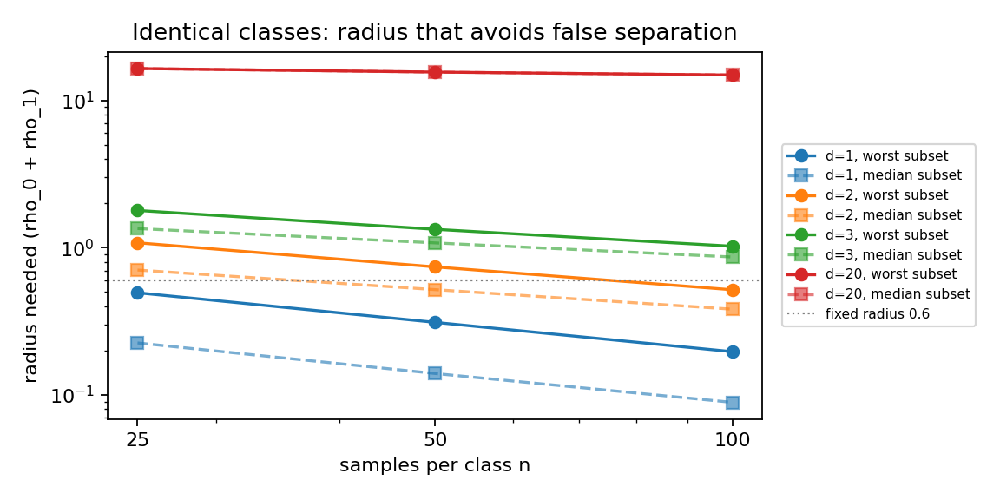
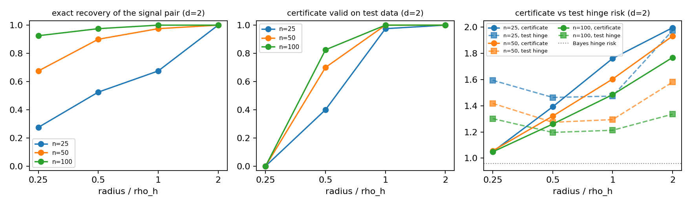

# 20-dimensional checks of the research directions

Development checks, not formal performance results. Generated by `scripts/run_study20.py summarize`.

Model version `full_support_standard_hinge_cone_v3`, code commit `0eb179a42b584c716aa4b955c3624eeac881121c`, Python 3.13.11, NumPy 2.4.4, SciPy 1.17.1.

Provenance: `development.json` and the confirmation files were produced from the working tree on
top of commit `0eb179a`, before the study code (`src/robusthw/experiments/study20.py`,
`configs/study20.json`, `scripts/run_study20.py`) and the retry in `selection._master` (HiGHS
scheduler started with another thread count) were committed; they were committed together with
these results. The retry only affects runs that previously stopped with `solver_error`. `develop.log`
and `confirm.log` are committed despite the `*.log` ignore rule; the confirmation exited with status 0.
The two outer-approximation runs that stopped at the 600 s limit (d = 3) are kept in
`computation.json` with status `time_limit`.

Proposition, theorem and equation numbers refer to the research-directions note `note/directions/research_directions.pdf`.

Development: honest radii from 40 null draws per n; signal shift chosen from [1.0, 1.5] (exact-recovery rate at n=100, rho_h: {'1.0': 1.0, '1.5': 1.0}) -> 1.0.

## Experiment 1: identical classes (false separation)

Both classes N(0, I_20), 40 confirmation draws per n. 'Needed radius' of S is the smallest rho_0+rho_1 with V(S) >= 1.92; above it the certificate does not separate identical classes. rho_h is the development 95% quantile of the largest needed radius over all subsets of size d (frozen before confirmation).

| d | n | rho_h (dev) | max_S needed | median_S needed | Prop. 8 bound | subsets below bound | false sep. at rho_h | false sep. at 0.6 | best V at 0.6 |
|---|---|---|---|---|---|---|---|---|---|
| 1 | 25 | 0.664 | 0.494 | 0.225 | 0.002 | 0.000 | 0.12 | 0.17 | 1.96 |
| 1 | 50 | 0.465 | 0.311 | 0.140 | 0.001 | 0.000 | 0.05 | 0.00 | 2.00 |
| 1 | 100 | 0.267 | 0.196 | 0.089 | 0.001 | 0.000 | 0.12 | 0.00 | 2.00 |
| 2 | 25 | 1.276 | 1.078 | 0.704 | 0.042 | 0.000 | 0.07 | 1.00 | 1.57 |
| 2 | 50 | 0.896 | 0.740 | 0.518 | 0.030 | 0.000 | 0.07 | 1.00 | 1.83 |
| 2 | 100 | 0.602 | 0.517 | 0.381 | 0.021 | 0.000 | 0.07 | 0.07 | 1.97 |
| 3 | 25 | 1.970 | 1.789 | 1.347 | 0.137 | 0.000 | 0.07 | 1.00 | 1.03 |
| 3 | 50 | 1.460 | 1.332 | 1.076 | 0.109 | 0.000 | 0.07 | 1.00 | 1.29 |
| 3 | 100 | 1.079 | 1.022 | 0.864 | 0.086 | 0.000 | 0.07 | 1.00 | 1.52 |
| 20 | 25 | 17.256 | 16.472 | 16.472 | 3.369 | 0.000 | 0.03 | 1.00 | 0.10 |
| 20 | 50 | 16.043 | 15.590 | 15.590 | 3.255 | 0.000 | 0.12 | 1.00 | 0.10 |
| 20 | 100 | 15.135 | 14.894 | 14.894 | 3.144 | 0.000 | 0.12 | 1.00 | 0.11 |

Log-log slopes of the needed radius against n (mean over draws):

| d | slope of max_S radius | slope of median_S radius | theory (W1 rate) |
|---|---|---|---|
| 1 | -0.67 | -0.67 | -1/2 |
| 2 | -0.53 | -0.44 | -1/2 (log) |
| 3 | -0.40 | -0.32 | -1/3 |
| 20 | -0.07 | -0.07 | -1/20 |

## Experiment 2: signal on two coordinates (validity, recovery, choice of d)

Class 1 is shifted by 1.0 in coordinates [0, 1] (chosen on development seeds); Bayes hinge risk on the signal pair B = 0.959, Bayes total error 0.480. 40 confirmation draws per n; test sets of 20000 per class. A certificate is counted valid when the test hinge risk is at most the certificate plus two Monte Carlo standard errors.

Budget d = 2 (the true size):

| radius | n | radius used | exact recovery | certificate V(S_hat) | test hinge | valid | test total error |
|---|---|---|---|---|---|---|---|
| fixed 0.6 | 25 | 0.60 | 0.53 | 1.361 | 1.464 | 0.33 | 0.618 |
| fixed 0.6 | 50 | 0.60 | 0.93 | 1.435 | 1.273 | 0.93 | 0.507 |
| fixed 0.6 | 100 | 0.60 | 1.00 | 1.484 | 1.213 | 1.00 | 0.485 |
| 0.25 rho_h | 25 | 0.32 | 0.28 | 1.050 | 1.594 | 0.00 | 0.716 |
| 0.25 rho_h | 50 | 0.22 | 0.68 | 1.056 | 1.418 | 0.00 | 0.609 |
| 0.25 rho_h | 100 | 0.15 | 0.93 | 1.049 | 1.301 | 0.00 | 0.547 |
| 0.5 rho_h | 25 | 0.64 | 0.53 | 1.392 | 1.463 | 0.40 | 0.615 |
| 0.5 rho_h | 50 | 0.45 | 0.90 | 1.321 | 1.274 | 0.70 | 0.517 |
| 0.5 rho_h | 100 | 0.30 | 0.97 | 1.260 | 1.197 | 0.82 | 0.501 |
| rho_h | 25 | 1.28 | 0.68 | 1.761 | 1.474 | 0.97 | 0.576 |
| rho_h | 50 | 0.90 | 0.97 | 1.604 | 1.294 | 1.00 | 0.494 |
| rho_h | 100 | 0.60 | 1.00 | 1.485 | 1.213 | 1.00 | 0.485 |
| 2 rho_h | 25 | 2.55 | 1.00 | 1.995 | 1.974 | 1.00 | 0.975 |
| 2 rho_h | 50 | 1.79 | 1.00 | 1.932 | 1.581 | 1.00 | 0.605 |
| 2 rho_h | 100 | 1.20 | 1.00 | 1.768 | 1.336 | 1.00 | 0.484 |

Budget chosen by the certificate among d in [1, 2, 3] (Corollary 11):

| radius | n | share of d=1 / 2 / 3 | signal pair inside | certificate | test hinge | valid |
|---|---|---|---|---|---|---|
| fixed 0.6 | 25 | 0.00 / 0.00 / 1.00 | 0.28 | 0.944 | 1.755 | 0.00 |
| fixed 0.6 | 50 | 0.00 / 0.00 / 1.00 | 0.78 | 1.113 | 1.556 | 0.00 |
| fixed 0.6 | 100 | 0.00 / 0.00 / 1.00 | 1.00 | 1.260 | 1.427 | 0.00 |
| 0.25 rho_h | 25 | 0.00 / 0.00 / 1.00 | 0.25 | 0.823 | 1.789 | 0.00 |
| 0.25 rho_h | 50 | 0.00 / 0.00 / 1.00 | 0.57 | 0.829 | 1.672 | 0.00 |
| 0.25 rho_h | 100 | 0.00 / 0.00 / 1.00 | 0.78 | 0.835 | 1.634 | 0.00 |
| 0.5 rho_h | 25 | 0.00 / 0.00 / 1.00 | 0.45 | 1.283 | 1.669 | 0.00 |
| 0.5 rho_h | 50 | 0.00 / 0.00 / 1.00 | 0.88 | 1.233 | 1.515 | 0.00 |
| 0.5 rho_h | 100 | 0.00 / 0.07 / 0.93 | 0.95 | 1.202 | 1.436 | 0.03 |
| rho_h | 25 | 0.50 / 0.38 / 0.12 | 0.38 | 1.741 | 1.483 | 0.95 |
| rho_h | 50 | 0.10 / 0.90 / 0.00 | 0.90 | 1.600 | 1.299 | 1.00 |
| rho_h | 100 | 0.05 / 0.95 / 0.00 | 0.95 | 1.484 | 1.218 | 1.00 |
| 2 rho_h | 25 | 0.97 / 0.03 / 0.00 | 0.03 | 1.989 | 1.936 | 1.00 |
| 2 rho_h | 50 | 0.68 / 0.33 / 0.00 | 0.33 | 1.914 | 1.578 | 1.00 |
| 2 rho_h | 100 | 0.62 / 0.38 / 0.00 | 0.38 | 1.747 | 1.404 | 1.00 |

Largest |core fit_fixed value - 2 m_S| over all fitted detectors: 3.3e-11.

## Experiment 3: computation (rho_0 + rho_1 = 0.6)

Enumeration evaluates every subset through the matching form; program (2) is solved by HiGHS; outer approximation is the core Algorithm 1 (select method 'oa').

| n | d | enumeration | program (2) | relaxation of (2) | OA upper / lower | OA status |
|---|---|---|---|---|---|---|
| 25 | 2 | 1.2811 (0.1s) | 1.2811 (2.2s, 35 nodes) | 0.7142 | 1.2811 / 1.2811 | optimal, 190 subsets, 18s |
| 25 | 3 | 0.8762 (0.3s) | 0.8762 (9.5s, 1457 nodes) | 0.4881 | 0.8762 / 0.2842 | time_limit, 920 subsets, 600s |
| 50 | 2 | 1.3210 (0.2s) | 1.3210 (7.0s, 33 nodes) | 0.7776 | 1.3210 / 1.3210 | optimal, 190 subsets, 63s |
| 50 | 3 | 1.0242 (1.2s) | 1.0242 (40.0s, 1559 nodes) | 0.5316 | 1.0242 / 0.1731 | time_limit, 1090 subsets, 600s |

## Experiment 4: randomized selection

Worst-case values against the adversary (left) and test hinge risk when the data are simply drawn from the true distributions (right). W_T uses tangents at 23 radii; for d=1 the exact value is the water-filling level of Theorem 19.

| d | draws | fixed min V | randomized W_T | water-filling | relaxation | test hinge, fixed | test hinge, mixture |
|---|---|---|---|---|---|---|---|
| 1 | 5 | 1.765 | 1.200 | 1.189 | 1.371 | 1.475 | 1.915 |
| 2 | 5 | 1.394 | 0.446 | -- | 0.737 | 1.527 | 1.981 |
