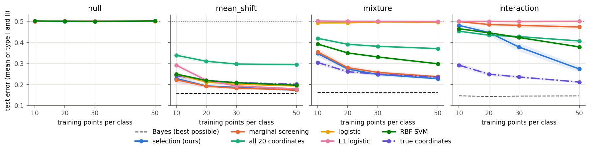
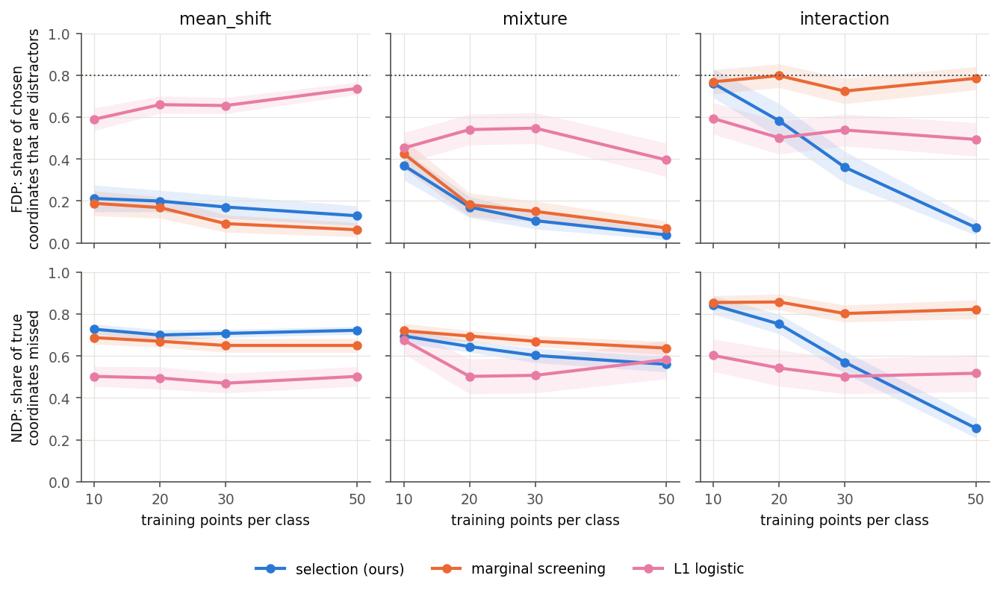
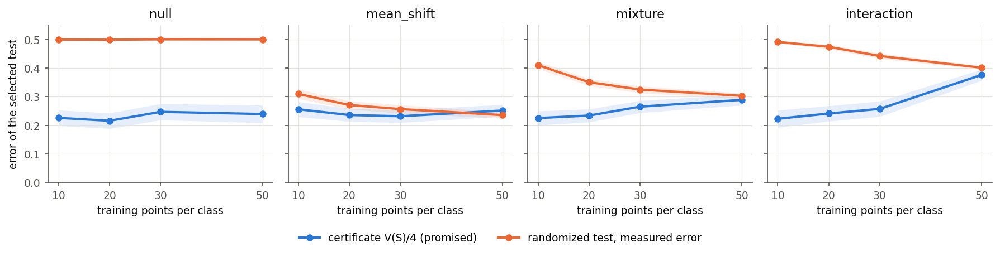
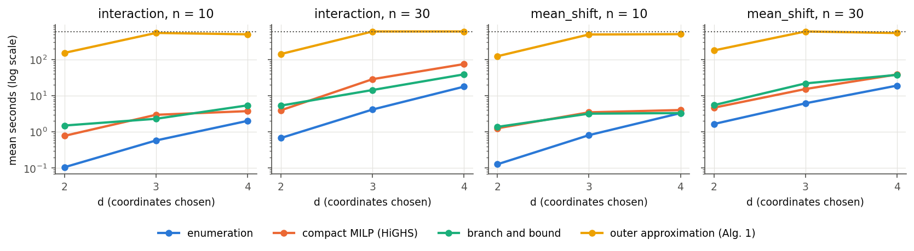

# study20-v3: four ground-truth coordinates among 16 distractors

Model `hinge_ratio_cut_v5`, commit `11f6ae012ef03b59f42dbafe2db7865dde5db723` (dirty: True). Generated by `scripts/run_study20.py summarize` from the JSON files in this directory; configuration `configs/study20.json`.

## Question

Two classes differ only on a few coordinates. Can a test built from a handful of training
points per class still tell them apart, and does it find the right coordinates? Each case has
D = 20 coordinates: **four ground-truth coordinates**, on which the two class distributions
differ, and **sixteen distractors**, which are independent of everything and have the same
distribution in both classes. Coordinates are shuffled in every trial, so no method can find
the ground truth by its index.

## Data

| case | ground-truth coordinates: class 0 vs class 1 | distractors (both classes) | source | what it tests |
|---|---|---|---|---|
| `null` | none (the classes are identical) | 20 x N(0, 1) | - | false alarms: every test should have error 0.5 |
| `mean_shift` | N(0, S) vs N(mu, S), mu = (2, 1, 0.67, 0.5), S_ab = 0.5^abs(a-b) | 16 x N(0, 1) | Wang, Dey, Xie (2023), case I | the common sparse signal, visible coordinate by coordinate |
| `mixture` | N(0, I) vs N(+-mu, I) with a random sign, mu as above | 16 x N(0, 1) | Wang, Dey, Xie (2023), case IV | same mean, larger spread: invisible to a linear rule |
| `interaction` | 1/2 N(c0, I) + 1/2 N(-c0, I) vs the same with c1, c0 = (1, 1, 1, 1), c1 = (1, 1, -1, -1) | 16 x (1/2 N(1, 1) + 1/2 N(-1, 1)) | Xie, Gao, Xie (2021), Sec. 5.1, on four coordinates | every single coordinate has the same distribution in both classes; the signal is only in how the true coordinates move together |

The likelihood ratio depends on the ground-truth coordinates only, so the Bayes error (the
smallest error any test can reach, computed from the known densities on the test points) is
the same as with the four true coordinates alone.

## Protocol

As in Xie, Gao and Xie (2021, Sec. 5.1): in each trial draw n training points per class
(n = 10, 20, 30, 50) and 1000 fresh test points per class; choose every tuning parameter by 5-fold
cross-validation on the training points, minimizing the validation error; refit on all
training points; measure on the test points. 100 trials per case and n.

## Methods

| method | what it does | tuned by cross-validation |
|---|---|---|
| **selection (ours)** | among all subsets S of d coordinates, take the one with the smallest worst-case risk V(S); fit the robust test (Eq. (4)) on S and extend it to new points by Eq. (5) | d in 1..4 and the radius |
| marginal screening | score every coordinate alone by V({m}) and keep the d best; then the same robust test | d and the radius |
| all 20 coordinates | the robust test of Xie, Gao and Xie (2021) on all coordinates, no selection | the radius |
| true coordinates (reference) | the same robust test on the four ground-truth coordinates; not available in practice | the radius |
| logistic | logistic regression (a linear rule) on all coordinates; baseline of Xie, Gao and Xie | L2 penalty |
| L1 logistic | logistic regression with an L1 penalty, which sets the weights of unused coordinates to zero; sparse baseline of Wang, Dey and Xie | L1 penalty |
| RBF SVM | support vector machine with a Gaussian kernel (a curved rule); baseline of Xie, Gao and Xie | C |

The robust methods use the hinge loss and the l1 transport cost; the radius grid is 17
values from 0.01 to 100 on a log scale, split equally between the classes.

## Metrics

A test declares class 0 or class 1 for each point; for the robust tests, a nonnegative score
means class 0.

- **Type I error** = share of class-0 test points declared class 1.
  **Type II error** = share of class-1 test points declared class 0.
- **Test error** = (type I + type II) / 2. A coin flip gives 0.5; the Bayes error is the floor.
- **FDP** (false discovery proportion) = |S minus truth| / |S|: the share of chosen coordinates
  that are distractors. **NDP** (non-discovery proportion) = |truth minus S| / 4: the share of
  ground-truth coordinates missed (Wang, Dey and Xie 2023, Eq. (24)). Choosing d coordinates at
  random gives FDP = 0.8 and NDP = 1 - d/20.
- **Certificate** = V(S)/4, computed from the training points alone: the largest average error
  that the randomized test (declare class 0 with probability (1 + g)/2, g the score) can have
  when each true class distribution lies in its Wasserstein ball. **Randomized error** is that
  test's average error measured on the test points; the certificate **holds** in a trial when
  certificate >= randomized error.

Every number below is a mean over trials; standard errors are in parentheses, and the bands in
the figures are +-2 standard errors.

## Results

### Can the test tell the classes apart?

Test error by case (rows: methods, columns: training points per class).

**null**

| method | n = 10 | n = 20 | n = 30 | n = 50 |
|---|---|---|---|---|
| Bayes | 0.500 (0.000) | 0.500 (0.000) | 0.500 (0.000) | 0.500 (0.000) |
| selection (ours) | 0.499 (0.001) | 0.499 (0.001) | 0.501 (0.001) | 0.500 (0.001) |
| marginal screening | 0.500 (0.001) | 0.501 (0.001) | 0.501 (0.001) | 0.501 (0.001) |
| all 20 coordinates | 0.500 (0.001) | 0.500 (0.001) | 0.499 (0.001) | 0.501 (0.001) |
| logistic | 0.499 (0.001) | 0.501 (0.001) | 0.501 (0.001) | 0.501 (0.001) |
| L1 logistic | 0.499 (0.001) | 0.501 (0.001) | 0.500 (0.001) | 0.501 (0.001) |
| RBF SVM | 0.502 (0.001) | 0.500 (0.001) | 0.499 (0.001) | 0.501 (0.001) |

**mean_shift**

| method | n = 10 | n = 20 | n = 30 | n = 50 |
|---|---|---|---|---|
| Bayes | 0.158 (0.001) | 0.156 (0.001) | 0.157 (0.001) | 0.156 (0.001) |
| selection (ours) | 0.228 (0.009) | 0.192 (0.004) | 0.185 (0.003) | 0.172 (0.002) |
| marginal screening | 0.222 (0.008) | 0.191 (0.004) | 0.182 (0.003) | 0.174 (0.002) |
| all 20 coordinates | 0.338 (0.006) | 0.310 (0.004) | 0.297 (0.003) | 0.294 (0.003) |
| true coordinates | 0.242 (0.005) | 0.219 (0.003) | 0.209 (0.002) | 0.200 (0.002) |
| logistic | 0.248 (0.004) | 0.211 (0.002) | 0.201 (0.002) | 0.193 (0.002) |
| L1 logistic | 0.291 (0.006) | 0.219 (0.004) | 0.192 (0.003) | 0.178 (0.002) |
| RBF SVM | 0.249 (0.004) | 0.218 (0.002) | 0.208 (0.002) | 0.196 (0.002) |

**mixture**

| method | n = 10 | n = 20 | n = 30 | n = 50 |
|---|---|---|---|---|
| Bayes | 0.161 (0.001) | 0.161 (0.001) | 0.160 (0.001) | 0.160 (0.001) |
| selection (ours) | 0.347 (0.008) | 0.273 (0.005) | 0.247 (0.004) | 0.227 (0.003) |
| marginal screening | 0.354 (0.009) | 0.280 (0.006) | 0.257 (0.005) | 0.237 (0.003) |
| all 20 coordinates | 0.419 (0.003) | 0.391 (0.004) | 0.381 (0.003) | 0.370 (0.003) |
| true coordinates | 0.304 (0.005) | 0.260 (0.004) | 0.249 (0.003) | 0.235 (0.002) |
| logistic | 0.493 (0.002) | 0.493 (0.002) | 0.497 (0.002) | 0.495 (0.001) |
| L1 logistic | 0.501 (0.001) | 0.500 (0.001) | 0.500 (0.001) | 0.499 (0.001) |
| RBF SVM | 0.392 (0.003) | 0.349 (0.003) | 0.330 (0.003) | 0.298 (0.003) |

**interaction**

| method | n = 10 | n = 20 | n = 30 | n = 50 |
|---|---|---|---|---|
| Bayes | 0.145 (0.001) | 0.144 (0.001) | 0.144 (0.001) | 0.145 (0.001) |
| selection (ours) | 0.480 (0.005) | 0.446 (0.007) | 0.377 (0.010) | 0.273 (0.007) |
| marginal screening | 0.498 (0.002) | 0.485 (0.004) | 0.481 (0.005) | 0.473 (0.006) |
| all 20 coordinates | 0.453 (0.002) | 0.434 (0.003) | 0.427 (0.003) | 0.406 (0.002) |
| true coordinates | 0.291 (0.006) | 0.248 (0.004) | 0.235 (0.003) | 0.211 (0.002) |
| logistic | 0.498 (0.001) | 0.499 (0.001) | 0.498 (0.001) | 0.500 (0.001) |
| L1 logistic | 0.499 (0.001) | 0.499 (0.001) | 0.499 (0.001) | 0.500 (0.001) |
| RBF SVM | 0.464 (0.002) | 0.445 (0.002) | 0.423 (0.003) | 0.378 (0.003) |

Type I / type II error (means).

**null**

| method | n = 10 | n = 20 | n = 30 | n = 50 |
|---|---|---|---|---|
| Bayes | 0.00 / 1.00 | 0.00 / 1.00 | 0.00 / 1.00 | 0.00 / 1.00 |
| selection (ours) | 0.46 / 0.54 | 0.49 / 0.51 | 0.47 / 0.54 | 0.45 / 0.55 |
| marginal screening | 0.46 / 0.54 | 0.46 / 0.54 | 0.48 / 0.52 | 0.43 / 0.57 |
| all 20 coordinates | 0.51 / 0.49 | 0.34 / 0.66 | 0.36 / 0.64 | 0.32 / 0.68 |
| logistic | 0.49 / 0.51 | 0.51 / 0.50 | 0.50 / 0.50 | 0.49 / 0.51 |
| L1 logistic | 0.39 / 0.61 | 0.38 / 0.62 | 0.35 / 0.65 | 0.33 / 0.67 |
| RBF SVM | 0.50 / 0.50 | 0.51 / 0.49 | 0.50 / 0.49 | 0.49 / 0.51 |

**mean_shift**

| method | n = 10 | n = 20 | n = 30 | n = 50 |
|---|---|---|---|---|
| Bayes | 0.16 / 0.16 | 0.16 / 0.15 | 0.16 / 0.16 | 0.16 / 0.16 |
| selection (ours) | 0.23 / 0.22 | 0.18 / 0.20 | 0.17 / 0.20 | 0.17 / 0.17 |
| marginal screening | 0.23 / 0.22 | 0.19 / 0.20 | 0.17 / 0.19 | 0.17 / 0.18 |
| all 20 coordinates | 0.30 / 0.38 | 0.27 / 0.35 | 0.25 / 0.35 | 0.25 / 0.34 |
| true coordinates | 0.22 / 0.26 | 0.19 / 0.25 | 0.19 / 0.23 | 0.18 / 0.22 |
| logistic | 0.28 / 0.22 | 0.22 / 0.21 | 0.20 / 0.20 | 0.20 / 0.19 |
| L1 logistic | 0.43 / 0.15 | 0.30 / 0.13 | 0.25 / 0.14 | 0.22 / 0.14 |
| RBF SVM | 0.25 / 0.25 | 0.22 / 0.22 | 0.21 / 0.21 | 0.20 / 0.19 |

**mixture**

| method | n = 10 | n = 20 | n = 30 | n = 50 |
|---|---|---|---|---|
| Bayes | 0.14 / 0.18 | 0.14 / 0.18 | 0.14 / 0.18 | 0.14 / 0.18 |
| selection (ours) | 0.27 / 0.43 | 0.20 / 0.35 | 0.17 / 0.32 | 0.15 / 0.31 |
| marginal screening | 0.28 / 0.43 | 0.21 / 0.34 | 0.19 / 0.32 | 0.17 / 0.30 |
| all 20 coordinates | 0.32 / 0.52 | 0.25 / 0.54 | 0.24 / 0.52 | 0.22 / 0.52 |
| true coordinates | 0.19 / 0.42 | 0.15 / 0.37 | 0.14 / 0.36 | 0.12 / 0.35 |
| logistic | 0.46 / 0.53 | 0.47 / 0.51 | 0.48 / 0.51 | 0.49 / 0.50 |
| L1 logistic | 0.32 / 0.68 | 0.35 / 0.65 | 0.34 / 0.66 | 0.25 / 0.75 |
| RBF SVM | 0.33 / 0.46 | 0.30 / 0.40 | 0.28 / 0.38 | 0.27 / 0.33 |

**interaction**

| method | n = 10 | n = 20 | n = 30 | n = 50 |
|---|---|---|---|---|
| Bayes | 0.14 / 0.14 | 0.14 / 0.14 | 0.14 / 0.15 | 0.15 / 0.14 |
| selection (ours) | 0.44 / 0.52 | 0.41 / 0.48 | 0.36 / 0.40 | 0.23 / 0.32 |
| marginal screening | 0.45 / 0.54 | 0.46 / 0.51 | 0.45 / 0.51 | 0.44 / 0.50 |
| all 20 coordinates | 0.35 / 0.56 | 0.37 / 0.50 | 0.32 / 0.53 | 0.35 / 0.46 |
| true coordinates | 0.27 / 0.31 | 0.20 / 0.29 | 0.20 / 0.27 | 0.18 / 0.24 |
| logistic | 0.49 / 0.51 | 0.50 / 0.49 | 0.50 / 0.50 | 0.50 / 0.50 |
| L1 logistic | 0.36 / 0.64 | 0.31 / 0.69 | 0.33 / 0.67 | 0.30 / 0.70 |
| RBF SVM | 0.47 / 0.45 | 0.44 / 0.45 | 0.42 / 0.43 | 0.38 / 0.38 |

### Does it find the ground-truth coordinates?

The dotted line FDP = 0.8 is random choice.

| case | method | n | FDP | NDP | mean |S| |
|---|---|---|---|---|---|
| mean_shift | selection (ours) | 10 | 0.212 (0.032) | 0.728 (0.012) | 1.6 |
| mean_shift | selection (ours) | 20 | 0.199 (0.026) | 0.700 (0.013) | 1.7 |
| mean_shift | selection (ours) | 30 | 0.171 (0.027) | 0.708 (0.009) | 1.7 |
| mean_shift | selection (ours) | 50 | 0.129 (0.024) | 0.723 (0.009) | 1.4 |
| mean_shift | marginal screening | 10 | 0.188 (0.030) | 0.688 (0.015) | 1.8 |
| mean_shift | marginal screening | 20 | 0.168 (0.025) | 0.670 (0.015) | 1.8 |
| mean_shift | marginal screening | 30 | 0.092 (0.021) | 0.650 (0.016) | 1.7 |
| mean_shift | marginal screening | 50 | 0.062 (0.017) | 0.650 (0.017) | 1.6 |
| mean_shift | L1 logistic | 10 | 0.590 (0.027) | 0.502 (0.024) | 7.0 |
| mean_shift | L1 logistic | 20 | 0.659 (0.020) | 0.495 (0.027) | 7.7 |
| mean_shift | L1 logistic | 30 | 0.655 (0.019) | 0.470 (0.023) | 7.5 |
| mean_shift | L1 logistic | 50 | 0.736 (0.015) | 0.502 (0.023) | 8.2 |
| mixture | selection (ours) | 10 | 0.369 (0.035) | 0.695 (0.017) | 2.1 |
| mixture | selection (ours) | 20 | 0.171 (0.025) | 0.645 (0.014) | 1.9 |
| mixture | selection (ours) | 30 | 0.106 (0.020) | 0.603 (0.017) | 1.9 |
| mixture | selection (ours) | 50 | 0.037 (0.011) | 0.560 (0.018) | 1.9 |
| mixture | marginal screening | 10 | 0.425 (0.035) | 0.720 (0.018) | 2.2 |
| mixture | marginal screening | 20 | 0.182 (0.028) | 0.695 (0.013) | 1.8 |
| mixture | marginal screening | 30 | 0.150 (0.025) | 0.670 (0.013) | 1.8 |
| mixture | marginal screening | 50 | 0.071 (0.017) | 0.637 (0.016) | 1.7 |
| mixture | L1 logistic | 10 | 0.452 (0.037) | 0.675 (0.032) | 5.4 |
| mixture | L1 logistic | 20 | 0.540 (0.036) | 0.502 (0.042) | 9.3 |
| mixture | L1 logistic | 30 | 0.547 (0.037) | 0.507 (0.042) | 9.7 |
| mixture | L1 logistic | 50 | 0.395 (0.040) | 0.583 (0.046) | 8.1 |
| interaction | selection (ours) | 10 | 0.761 (0.034) | 0.843 (0.022) | 2.2 |
| interaction | selection (ours) | 20 | 0.583 (0.041) | 0.752 (0.023) | 2.3 |
| interaction | selection (ours) | 30 | 0.361 (0.038) | 0.570 (0.026) | 2.7 |
| interaction | selection (ours) | 50 | 0.072 (0.018) | 0.255 (0.024) | 3.2 |
| interaction | marginal screening | 10 | 0.768 (0.029) | 0.855 (0.016) | 2.5 |
| interaction | marginal screening | 20 | 0.797 (0.028) | 0.858 (0.019) | 2.6 |
| interaction | marginal screening | 30 | 0.724 (0.030) | 0.802 (0.020) | 2.8 |
| interaction | marginal screening | 50 | 0.785 (0.028) | 0.823 (0.023) | 2.8 |
| interaction | L1 logistic | 10 | 0.593 (0.038) | 0.603 (0.038) | 8.2 |
| interaction | L1 logistic | 20 | 0.501 (0.039) | 0.542 (0.043) | 8.9 |
| interaction | L1 logistic | 30 | 0.538 (0.038) | 0.502 (0.042) | 10.1 |
| interaction | L1 logistic | 50 | 0.493 (0.040) | 0.517 (0.044) | 9.9 |

### Does the certificate hold?

Selection (ours): the promised worst-case error V(S)/4 against the measured error of the randomized test, at the cross-validated radius.

held = share of trials with certificate >= randomized error; ends = share of trials whose radius is an end of the grid; d = 1/2/3/4 counts the chosen sizes.

| case | method | n | certificate | randomized | held | median radius | ends | d = 1/2/3/4 |
|---|---|---|---|---|---|---|---|---|
| null | selection (ours) | 10 | 0.226 (0.014) | 0.500 (0.001) | 0.02 | 0.316 | 0.09 | 47/19/16/18 |
| null | selection (ours) | 20 | 0.216 (0.013) | 0.499 (0.001) | 0.00 | 0.139 | 0.06 | 36/32/21/11 |
| null | selection (ours) | 30 | 0.247 (0.014) | 0.500 (0.001) | 0.02 | 0.139 | 0.03 | 31/31/20/18 |
| null | selection (ours) | 50 | 0.239 (0.015) | 0.500 (0.001) | 0.01 | 0.178 | 0.08 | 29/25/19/27 |
| null | marginal screening | 10 | 0.196 (0.016) | 0.500 (0.001) | 0.02 | 0.178 | 0.12 | 32/28/21/19 |
| null | marginal screening | 20 | 0.227 (0.015) | 0.500 (0.001) | 0.03 | 0.178 | 0.11 | 32/22/21/25 |
| null | marginal screening | 30 | 0.208 (0.015) | 0.500 (0.001) | 0.00 | 0.1 | 0.16 | 25/20/25/30 |
| null | marginal screening | 50 | 0.247 (0.015) | 0.500 (0.001) | 0.01 | 0.1 | 0.08 | 27/22/25/26 |
| null | all 20 coordinates | 10 | 0.338 (0.017) | 0.500 (0.000) | 0.18 | 17.8 | 0.16 | - |
| null | all 20 coordinates | 20 | 0.284 (0.018) | 0.500 (0.000) | 0.28 | 10 | 0.19 | - |
| null | all 20 coordinates | 30 | 0.241 (0.017) | 0.500 (0.000) | 0.18 | 5.62 | 0.13 | - |
| null | all 20 coordinates | 50 | 0.221 (0.020) | 0.500 (0.000) | 0.26 | 3.16 | 0.24 | - |
| mean_shift | selection (ours) | 10 | 0.256 (0.013) | 0.310 (0.008) | 0.44 | 0.562 | 0.02 | 61/26/9/4 |
| mean_shift | selection (ours) | 20 | 0.236 (0.011) | 0.271 (0.007) | 0.43 | 0.316 | 0.00 | 52/32/11/5 |
| mean_shift | selection (ours) | 30 | 0.232 (0.011) | 0.257 (0.007) | 0.52 | 0.316 | 0.02 | 58/24/12/6 |
| mean_shift | selection (ours) | 50 | 0.252 (0.010) | 0.236 (0.006) | 0.57 | 0.178 | 0.02 | 69/20/10/1 |
| mean_shift | marginal screening | 10 | 0.231 (0.013) | 0.311 (0.008) | 0.35 | 0.562 | 0.02 | 57/20/11/12 |
| mean_shift | marginal screening | 20 | 0.215 (0.012) | 0.278 (0.008) | 0.42 | 0.178 | 0.04 | 52/26/10/12 |
| mean_shift | marginal screening | 30 | 0.226 (0.010) | 0.251 (0.007) | 0.42 | 0.247 | 0.03 | 59/20/14/7 |
| mean_shift | marginal screening | 50 | 0.246 (0.011) | 0.245 (0.006) | 0.64 | 0.316 | 0.03 | 61/25/9/5 |
| mean_shift | all 20 coordinates | 10 | 0.291 (0.017) | 0.478 (0.001) | 0.12 | 10 | 0.05 | - |
| mean_shift | all 20 coordinates | 20 | 0.286 (0.017) | 0.476 (0.001) | 0.22 | 10 | 0.00 | - |
| mean_shift | all 20 coordinates | 30 | 0.280 (0.016) | 0.474 (0.001) | 0.27 | 10 | 0.00 | - |
| mean_shift | all 20 coordinates | 50 | 0.282 (0.015) | 0.475 (0.001) | 0.23 | 10 | 0.00 | - |
| mean_shift | true coordinates | 10 | 0.256 (0.014) | 0.390 (0.003) | 0.28 | 1 | 0.01 | - |
| mean_shift | true coordinates | 20 | 0.254 (0.014) | 0.377 (0.002) | 0.27 | 1 | 0.01 | - |
| mean_shift | true coordinates | 30 | 0.290 (0.011) | 0.359 (0.002) | 0.37 | 1.78 | 0.00 | - |
| mean_shift | true coordinates | 50 | 0.277 (0.011) | 0.352 (0.002) | 0.38 | 1 | 0.00 | - |
| mixture | selection (ours) | 10 | 0.225 (0.012) | 0.410 (0.006) | 0.12 | 0.562 | 0.02 | 39/26/20/15 |
| mixture | selection (ours) | 20 | 0.234 (0.011) | 0.351 (0.006) | 0.21 | 0.316 | 0.04 | 45/27/19/9 |
| mixture | selection (ours) | 30 | 0.265 (0.011) | 0.325 (0.006) | 0.42 | 0.316 | 0.01 | 45/28/15/12 |
| mixture | selection (ours) | 50 | 0.289 (0.009) | 0.303 (0.005) | 0.48 | 0.562 | 0.01 | 38/41/17/4 |
| mixture | marginal screening | 10 | 0.171 (0.013) | 0.417 (0.006) | 0.07 | 0.178 | 0.04 | 33/29/23/15 |
| mixture | marginal screening | 20 | 0.203 (0.012) | 0.347 (0.007) | 0.21 | 0.178 | 0.08 | 61/14/14/11 |
| mixture | marginal screening | 30 | 0.229 (0.010) | 0.327 (0.007) | 0.33 | 0.178 | 0.02 | 55/23/9/13 |
| mixture | marginal screening | 50 | 0.232 (0.009) | 0.301 (0.006) | 0.34 | 0.1 | 0.02 | 58/24/9/9 |
| mixture | all 20 coordinates | 10 | 0.232 (0.016) | 0.491 (0.000) | 0.05 | 5.62 | 0.05 | - |
| mixture | all 20 coordinates | 20 | 0.213 (0.017) | 0.489 (0.000) | 0.05 | 5.62 | 0.04 | - |
| mixture | all 20 coordinates | 30 | 0.188 (0.015) | 0.488 (0.000) | 0.07 | 5.62 | 0.01 | - |
| mixture | all 20 coordinates | 50 | 0.193 (0.015) | 0.488 (0.000) | 0.07 | 5.62 | 0.00 | - |
| mixture | true coordinates | 10 | 0.216 (0.014) | 0.433 (0.002) | 0.10 | 1 | 0.02 | - |
| mixture | true coordinates | 20 | 0.222 (0.013) | 0.414 (0.002) | 0.11 | 1 | 0.00 | - |
| mixture | true coordinates | 30 | 0.241 (0.012) | 0.405 (0.001) | 0.03 | 1 | 0.00 | - |
| mixture | true coordinates | 50 | 0.250 (0.012) | 0.395 (0.002) | 0.05 | 1 | 0.00 | - |
| interaction | selection (ours) | 10 | 0.223 (0.015) | 0.491 (0.002) | 0.06 | 0.439 | 0.05 | 37/22/20/21 |
| interaction | selection (ours) | 20 | 0.241 (0.013) | 0.474 (0.004) | 0.05 | 0.316 | 0.03 | 27/32/28/13 |
| interaction | selection (ours) | 30 | 0.257 (0.013) | 0.442 (0.005) | 0.14 | 0.562 | 0.01 | 7/42/27/24 |
| interaction | selection (ours) | 50 | 0.376 (0.010) | 0.401 (0.003) | 0.49 | 1.78 | 0.00 | 1/24/24/51 |
| interaction | marginal screening | 10 | 0.160 (0.015) | 0.499 (0.001) | 0.01 | 0.178 | 0.17 | 32/17/21/30 |
| interaction | marginal screening | 20 | 0.196 (0.016) | 0.495 (0.001) | 0.00 | 0.1 | 0.14 | 27/22/18/33 |
| interaction | marginal screening | 30 | 0.211 (0.016) | 0.493 (0.002) | 0.01 | 0.247 | 0.08 | 19/17/28/36 |
| interaction | marginal screening | 50 | 0.214 (0.016) | 0.492 (0.002) | 0.00 | 0.139 | 0.17 | 29/12/13/46 |
| interaction | all 20 coordinates | 10 | 0.216 (0.014) | 0.495 (0.000) | 0.09 | 10 | 0.09 | - |
| interaction | all 20 coordinates | 20 | 0.191 (0.016) | 0.494 (0.000) | 0.08 | 5.62 | 0.08 | - |
| interaction | all 20 coordinates | 30 | 0.230 (0.016) | 0.493 (0.000) | 0.07 | 10 | 0.07 | - |
| interaction | all 20 coordinates | 50 | 0.168 (0.015) | 0.492 (0.000) | 0.01 | 5.62 | 0.01 | - |
| interaction | true coordinates | 10 | 0.215 (0.014) | 0.430 (0.002) | 0.06 | 1.78 | 0.01 | - |
| interaction | true coordinates | 20 | 0.234 (0.015) | 0.414 (0.001) | 0.20 | 1 | 0.00 | - |
| interaction | true coordinates | 30 | 0.224 (0.014) | 0.406 (0.001) | 0.11 | 1 | 0.00 | - |
| interaction | true coordinates | 50 | 0.273 (0.014) | 0.392 (0.001) | 0.17 | 1.78 | 0.00 | - |

## Computation: exact selection

Selection has to find the subset with the smallest V(S) among all C(20, d) subsets. Four exact algorithms, at the radius that cross-validation chose for selection in the accuracy study, 10 trials per setting, time limit 600 s:

- **enumeration**: compute V(S) for every subset, by the matching form of V for the hinge loss (Hungarian algorithm);
- **compact MILP**: the whole selection problem written as one mixed-integer linear program (binary z_m = coordinate m chosen; Eq. (4) of the directions note) and solved by HiGHS. Its linear relaxation (z between 0 and 1) is the *commitment bound*;
- **branch and bound**: a search tree over "coordinate m in / out", pruned by the commitment bound of each node;
- **outer approximation** (Algorithm 1 of the theory note): solve one subset, add the ratio cut Eq. (8), solve the master problem Eq. (9) for the next subset.

Columns: share of trials solved to the optimum (checked against enumeration), mean seconds and the work done (MILP nodes, subsets evaluated by outer approximation, LPs of branch and bound); bound/opt = commitment bound / optimum.

| case | n | d | subsets | enum s | MILP opt | MILP s | MILP nodes | OA opt | OA subsets | OA s | B&B opt | B&B LPs | B&B s | bound/opt |
|---|---|---|---|---|---|---|---|---|---|---|---|---|---|---|
| interaction | 10 | 2 | 190 | 0.11 | 1.0 | 0.8 | 23 | 1.0 | 173 | 154 | 1.0 | 143 | 1.5 | 0.70 |
| interaction | 10 | 3 | 1140 | 0.58 | 1.0 | 3.0 | 498 | 0.1 | 296 | 547 | 1.0 | 275 | 2.3 | 0.74 |
| interaction | 10 | 4 | 4845 | 2.02 | 1.0 | 3.8 | 1214 | 0.1 | 234 | 500 | 1.0 | 550 | 5.4 | 0.77 |
| interaction | 30 | 2 | 190 | 0.68 | 1.0 | 4.0 | 34 | 1.0 | 190 | 143 | 1.0 | 226 | 5.4 | 0.60 |
| interaction | 30 | 3 | 1140 | 4.16 | 1.0 | 28.8 | 1497 | 0.0 | 405 | 600 | 1.0 | 1181 | 14.4 | 0.57 |
| interaction | 30 | 4 | 4845 | 17.88 | 1.0 | 75.3 | 5479 | 0.0 | 331 | 600 | 1.0 | 3124 | 39.1 | 0.60 |
| mean_shift | 10 | 2 | 190 | 0.13 | 1.0 | 1.3 | 23 | 1.0 | 157 | 124 | 1.0 | 121 | 1.4 | 0.70 |
| mean_shift | 10 | 3 | 1140 | 0.82 | 1.0 | 3.5 | 518 | 0.2 | 258 | 496 | 1.0 | 271 | 3.2 | 0.72 |
| mean_shift | 10 | 4 | 4845 | 3.32 | 1.0 | 4.0 | 1058 | 0.2 | 238 | 505 | 1.0 | 356 | 3.3 | 0.77 |
| mean_shift | 30 | 2 | 190 | 1.66 | 1.0 | 4.7 | 31 | 1.0 | 190 | 179 | 1.0 | 224 | 5.5 | 0.54 |
| mean_shift | 30 | 3 | 1140 | 6.19 | 1.0 | 15.4 | 1055 | 0.0 | 309 | 600 | 1.0 | 876 | 22.0 | 0.58 |
| mean_shift | 30 | 4 | 4845 | 19.07 | 1.0 | 38.8 | 3101 | 0.0 | 238 | 543 | 1.0 | 1498 | 37.8 | 0.64 |
